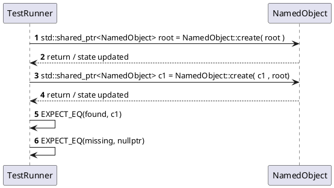

# Test Case: `TraversalTest.FindByName`

| Property | Value |
| :--- | :--- |
| **Module** | `named` |
| **Source File** | `cmake-projects/named/test/TestTraversal.cpp` (lines 65–88) |
| **Category** | Unit & Regression Verification |
| **Traceability** | See module specification (`FE-*` / `TSK-*`) |
| **Async Telemetry** | Standard GTest / CTest stdout |

## Summary

Executes verification scenario `TraversalTest.FindByName` defined in `cmake-projects/named/test/TestTraversal.cpp`.

## Sequence Diagram

## Observed Operations

- `std::shared_ptr<NamedObject> root = NamedObject::create("root")`
- `std::shared_ptr<NamedObject> c1 = NamedObject::create("c1", root)`

## Verification Assertions

- `EXPECT_EQ(found, c1)`
- `EXPECT_EQ(missing, nullptr)`

---

[Back to `named` Tests Overview](../named.md)
