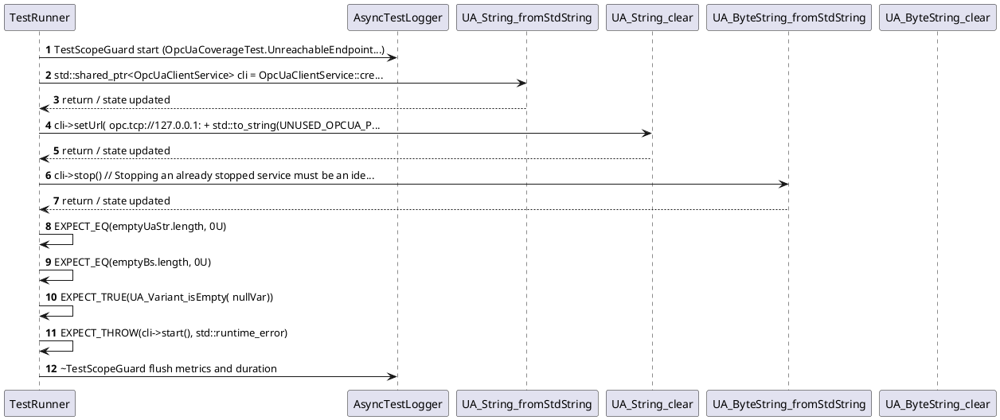

# Test Case: `OpcUaCoverageTest.UnreachableEndpointAndExceptionBoundaries`

| Property | Value |
| :--- | :--- |
| **Module** | `opcua` |
| **Source File** | `cmake-projects/opcua/test_cs0100/TestOpcUaExtended.cpp` (lines 211–232) |
| **Category** | Coverage, Enum, Boundary & Exception Containment (`CS-0100.1`, `CS-0100.3`, `CS-0100.4`, `CS-0100.6`, `CS-0100.9`) |
| **Traceability** | `[TSK-20260311-005]`, `[TSK-20261113-003]`, `[FE-0200]`, `[FE-0220]`, `[CS-0040.2]` |
| **Async Telemetry** | Enabled (`TestScopeGuard` + `AsyncTestLogger`) |

## Summary

Extended CS-0100 test suite for `quasar_opcua` covering server/client mirroring, `UA_Common`, `OpcUaSecurityManager`, error boundaries, fuzzing, and concurrent client task queues.

## Sequence Diagram

## Observed Operations

- `std::shared_ptr<OpcUaClientService> cli = OpcUaClientService::create("UnreachableClient")`
- `cli->setUrl("opc.tcp://127.0.0.1:" + std::to_string(UNUSED_OPCUA_PORT))`
- `cli->stop(); // Stopping an already stopped service must be an idempotent no-op.`

## Verification Assertions

- `EXPECT_EQ(emptyUaStr.length, 0U)`
- `EXPECT_EQ(emptyBs.length, 0U)`
- `EXPECT_TRUE(UA_Variant_isEmpty(&nullVar))`
- `EXPECT_THROW(cli->start(), std::runtime_error)`
- `EXPECT_FALSE(cli->isRunning())`

---

[Back to `opcua` Tests Overview](../opcua.md)
