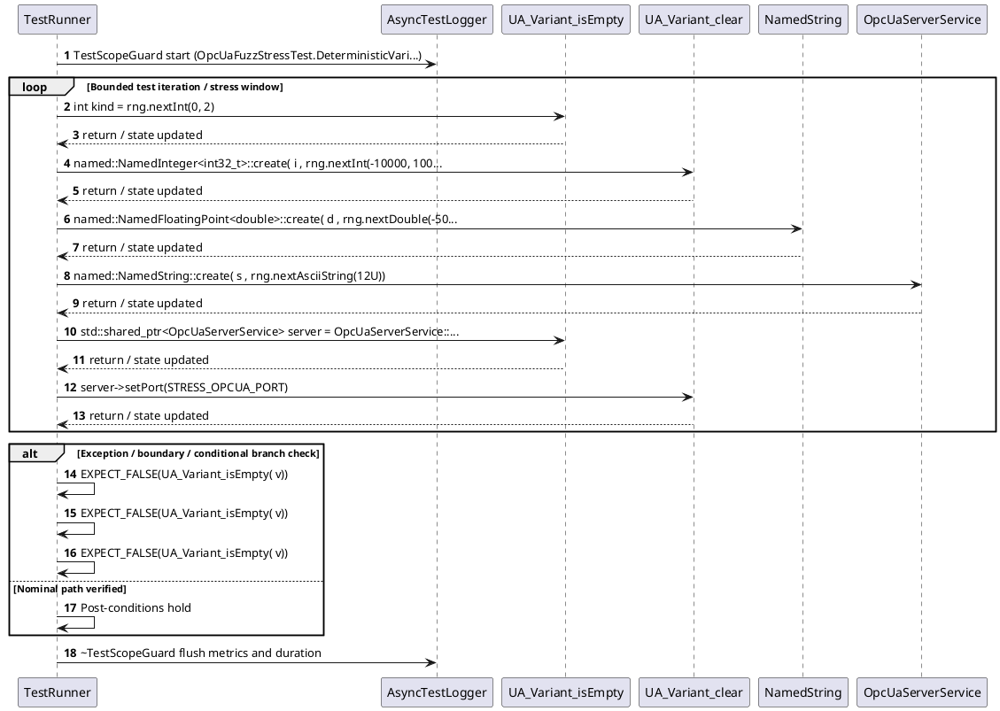

# Test Case: `OpcUaFuzzStressTest.DeterministicVariantFuzzAndConcurrentTaskQueue`

| Property | Value |
| :--- | :--- |
| **Module** | `opcua` |
| **Source File** | `cmake-projects/opcua/test_cs0100/TestOpcUaExtended.cpp` (lines 234–313) |
| **Category** | Determinism, Fuzzing, Concurrency & Stress (`CS-0100.7`, `CS-0100.10`, `CS-0100.11`, `CS-0100.12`) |
| **Traceability** | `[TSK-20260311-005]`, `[TSK-20261113-003]`, `[FE-0200]`, `[FE-0220]`, `[CS-0040.2]` |
| **Async Telemetry** | Enabled (`TestScopeGuard` + `AsyncTestLogger`) |

## Summary

Extended CS-0100 test suite for `quasar_opcua` covering server/client mirroring, `UA_Common`, `OpcUaSecurityManager`, error boundaries, fuzzing, and concurrent client task queues.

## Sequence Diagram

## Observed Operations

- `int kind = rng.nextInt(0, 2)`
- `named::NamedInteger<int32_t>::create("i", rng.nextInt(-10000, 10000))`
- `named::NamedFloatingPoint<double>::create("d", rng.nextDouble(-500.0, 500.0))`
- `named::NamedString::create("s", rng.nextAsciiString(12U))`
- `std::shared_ptr<OpcUaServerService> server = OpcUaServerService::create("StressSrv")`
- `server->setPort(STRESS_OPCUA_PORT)`
- `server->start()`
- `(void)waitCv.wait_for(waitLock, SERVER_STARTUP_WAIT_MS)`

## Verification Assertions

- `EXPECT_FALSE(UA_Variant_isEmpty(&v))`
- `EXPECT_FALSE(UA_Variant_isEmpty(&v))`
- `EXPECT_FALSE(UA_Variant_isEmpty(&v))`
- `EXPECT_EQ(fut.get(), static_cast<int>((w * 100U) + t))`

---

[Back to `opcua` Tests Overview](../opcua.md)
