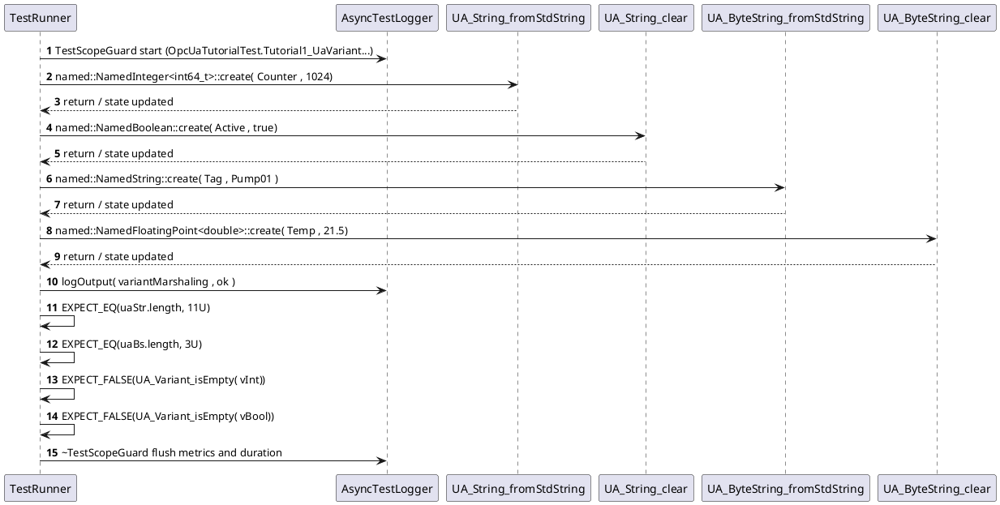

# Test Case: `OpcUaTutorialTest.Tutorial1_UaVariantConversionAndHelpers`

| Property | Value |
| :--- | :--- |
| **Module** | `opcua` |
| **Source File** | `cmake-projects/opcua/test_cs0100/TestOpcUaExtended.cpp` (lines 93–128) |
| **Category** | Pedagogical Tutorial (`CS-0100.19`) |
| **Traceability** | `[TSK-20260311-005]`, `[TSK-20261113-003]`, `[FE-0200]`, `[FE-0220]`, `[CS-0040.2]` |
| **Async Telemetry** | Enabled (`TestScopeGuard` + `AsyncTestLogger`) |

## Summary

Extended CS-0100 test suite for `quasar_opcua` covering server/client mirroring, `UA_Common`, `OpcUaSecurityManager`, error boundaries, fuzzing, and concurrent client task queues.

## Sequence Diagram

## Observed Operations

- `named::NamedInteger<int64_t>::create("Counter", 1024)`
- `named::NamedBoolean::create("Active", true)`
- `named::NamedString::create("Tag", "Pump01")`
- `named::NamedFloatingPoint<double>::create("Temp", 21.5)`
- `logOutput("variantMarshaling", "ok")`

## Verification Assertions

- `EXPECT_EQ(uaStr.length, 11U)`
- `EXPECT_EQ(uaBs.length, 3U)`
- `EXPECT_FALSE(UA_Variant_isEmpty(&vInt))`
- `EXPECT_FALSE(UA_Variant_isEmpty(&vBool))`
- `EXPECT_FALSE(UA_Variant_isEmpty(&vStr))`
- `EXPECT_FALSE(UA_Variant_isEmpty(&vDbl))`

---

[Back to `opcua` Tests Overview](../opcua.md)
