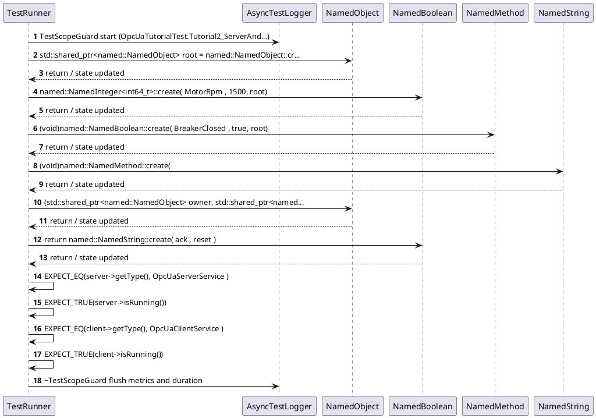

# Test Case: `OpcUaTutorialTest.Tutorial2_ServerAndClientMirroring`

| Property | Value |
| :--- | :--- |
| **Module** | `opcua` |
| **Source File** | `cmake-projects/opcua/test_cs0100/TestOpcUaExtended.cpp` (lines 130–177) |
| **Category** | Pedagogical Tutorial (`CS-0100.19`) |
| **Traceability** | `[TSK-20260311-005]`, `[TSK-20261113-003]`, `[FE-0200]`, `[FE-0220]`, `[CS-0040.2]` |
| **Async Telemetry** | Enabled (`TestScopeGuard` + `AsyncTestLogger`) |

## Summary

Extended CS-0100 test suite for `quasar_opcua` covering server/client mirroring, `UA_Common`, `OpcUaSecurityManager`, error boundaries, fuzzing, and concurrent client task queues.

## Sequence Diagram

## Observed Operations

- `std::shared_ptr<named::NamedObject> root = named::NamedObject::create("Substation")`
- `named::NamedInteger<int64_t>::create("MotorRpm", 1500, root)`
- `(void)named::NamedBoolean::create("BreakerClosed", true, root)`
- `(void)named::NamedMethod::create(`
- ` -> std::shared_ptr<named::NamedObject> {`
- `return named::NamedString::create("ack", "reset")`
- `std::shared_ptr<OpcUaServerService> server = OpcUaServerService::create("TestServer")`
- `server->setPort(TUTORIAL_OPCUA_PORT)`

## Verification Assertions

- `EXPECT_EQ(server->getType(), "OpcUaServerService")`
- `EXPECT_TRUE(server->isRunning())`
- `EXPECT_EQ(client->getType(), "OpcUaClientService")`
- `EXPECT_TRUE(client->isRunning())`
- `EXPECT_NE(mirroredRoot, nullptr)`
- `EXPECT_FALSE(client->isRunning())`
- `EXPECT_FALSE(server->isRunning())`

---

[Back to `opcua` Tests Overview](../opcua.md)
