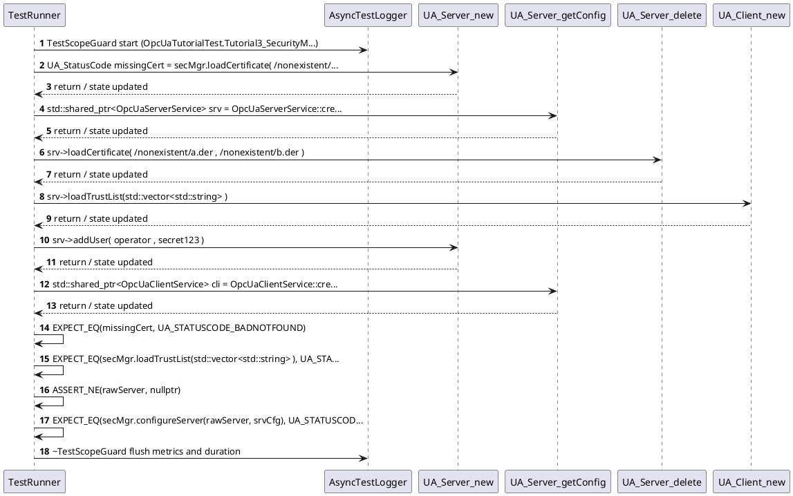

# Test Case: `OpcUaTutorialTest.Tutorial3_SecurityManagerAndCredentials`

| Property | Value |
| :--- | :--- |
| **Module** | `opcua` |
| **Source File** | `cmake-projects/opcua/test_cs0100/TestOpcUaExtended.cpp` (lines 179–209) |
| **Category** | Pedagogical Tutorial (`CS-0100.19`) |
| **Traceability** | `[TSK-20260311-005]`, `[TSK-20261113-003]`, `[FE-0200]`, `[FE-0220]`, `[CS-0040.2]` |
| **Async Telemetry** | Enabled (`TestScopeGuard` + `AsyncTestLogger`) |

## Summary

Extended CS-0100 test suite for `quasar_opcua` covering server/client mirroring, `UA_Common`, `OpcUaSecurityManager`, error boundaries, fuzzing, and concurrent client task queues.

## Sequence Diagram

## Observed Operations

- `UA_StatusCode missingCert = secMgr.loadCertificate("/nonexistent/cert.der", "/nonexistent/key.der")`
- `std::shared_ptr<OpcUaServerService> srv = OpcUaServerService::create("SecSrv")`
- `srv->loadCertificate("/nonexistent/a.der", "/nonexistent/b.der")`
- `srv->loadTrustList(std::vector<std::string>{})`
- `srv->addUser("operator", "secret123")`
- `std::shared_ptr<OpcUaClientService> cli = OpcUaClientService::create("SecCli")`
- `cli->loadCertificate("/nonexistent/a.der", "/nonexistent/b.der")`
- `cli->loadTrustList(std::vector<std::string>{})`

## Verification Assertions

- `EXPECT_EQ(missingCert, UA_STATUSCODE_BADNOTFOUND)`
- `EXPECT_EQ(secMgr.loadTrustList(std::vector<std::string>{}), UA_STATUSCODE_GOOD)`
- `ASSERT_NE(rawServer, nullptr)`
- `EXPECT_EQ(secMgr.configureServer(rawServer, srvCfg), UA_STATUSCODE_GOOD)`
- `ASSERT_NE(rawClient, nullptr)`
- `EXPECT_EQ(secMgr.configureClient(rawClient), UA_STATUSCODE_GOOD)`

---

[Back to `opcua` Tests Overview](../opcua.md)
