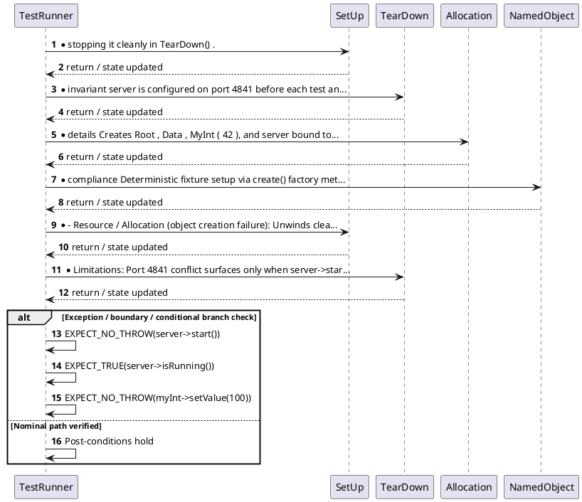

# Test Case: `opcua_test`

| Property | Value |
| :--- | :--- |
| **Module** | `opcua` |
| **Source File** | `cmake-projects/opcua/test/TestOpcUaServer.cpp` (lines 1–208) |
| **Category** | Unit & Regression Verification |
| **Traceability** | `TSK-20261113-003,`, `FE-0140,`, `CS-0010,`, `CS-0010.21,` |
| **Async Telemetry** | Standard GTest / CTest stdout |

## Summary

Unit tests verifying OpcUaServerService startup, address-space mapping, and method node registration.

## Sequence Diagram

## Observed Operations

- `* stopping it cleanly in `TearDown()`.`
- `* @invariant `server` is configured on port 4841 before each test and stopped in `TearDown()`.`
- `* @details Creates `Root`, `Data`, `MyInt` (`42`), and `server` bound to `root`.`
- `* @compliance Deterministic fixture setup via `create()` factory methods.`
- `*   - Resource / Allocation (object creation failure): Unwinds cleanly and aborts test.`
- `*   Limitations: Port 4841 conflict surfaces only when `server->start()` runs in test body.`
- `root = NamedObject::create("Root")`
- `data = NamedObject::create("Data", root)`

## Verification Assertions

- `EXPECT_NO_THROW(server->start())`
- `EXPECT_TRUE(server->isRunning())`
- `EXPECT_NO_THROW(myInt->setValue(100))`
- `EXPECT_NO_THROW(server->stop())`
- `EXPECT_FALSE(server->isRunning())`
- `EXPECT_NO_THROW(server->start())`
- `EXPECT_TRUE(server->isRunning())`
- `EXPECT_NO_THROW(server->stop())`

---

[Back to `opcua` Tests Overview](../opcua.md)
