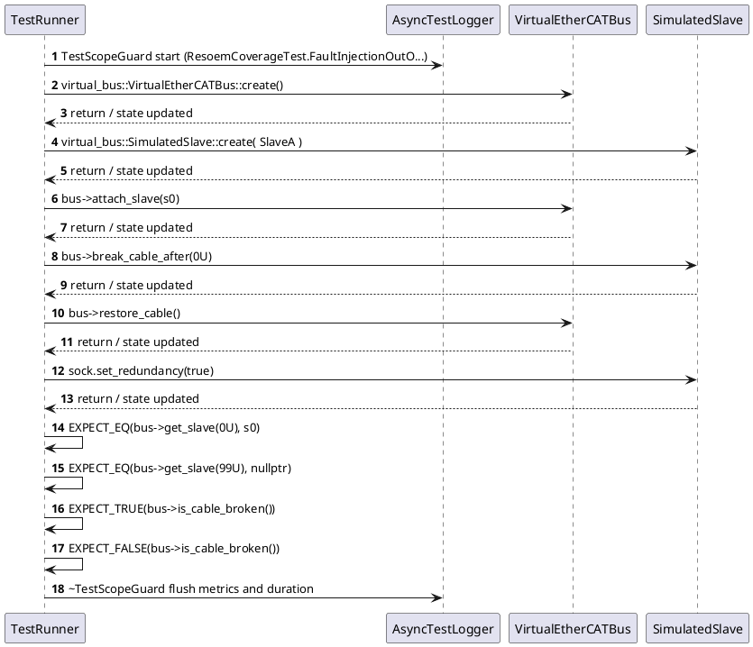

# Test Case: `ResoemCoverageTest.FaultInjectionOutOfBoundsAndRedundancyToggles`

| Property | Value |
| :--- | :--- |
| **Module** | `resoem` |
| **Source File** | `cmake-projects/resoem/test_cs0100/TestResoemExtended.cpp` (lines 121–151) |
| **Category** | Coverage, Enum, Boundary & Exception Containment (`CS-0100.1`, `CS-0100.3`, `CS-0100.4`, `CS-0100.6`, `CS-0100.9`) |
| **Traceability** | `[TSK-20260920-001]`, `[FE-0040]`, `[CS-0010.37]`, `[FE-0040.8]` |
| **Async Telemetry** | Enabled (`TestScopeGuard` + `AsyncTestLogger`) |

## Summary

Extended CS-0100 test suite for `resoem` virtual EtherCAT bus, frame builder, ENI parser, fault injection, and concurrency.

## Sequence Diagram

## Observed Operations

- `virtual_bus::VirtualEtherCATBus::create()`
- `virtual_bus::SimulatedSlave::create("SlaveA")`
- `bus->attach_slave(s0)`
- `bus->break_cable_after(0U)`
- `bus->restore_cable()`
- `sock.set_redundancy(true)`
- `sock.set_timeout(5)`
- `std::array<uint8_t, ETHERNET_MAC_ADDRESS_LENGTH> macPri = sock.get_mac_address(false)`

## Verification Assertions

- `EXPECT_EQ(bus->get_slave(0U), s0)`
- `EXPECT_EQ(bus->get_slave(99U), nullptr)`
- `EXPECT_TRUE(bus->is_cable_broken())`
- `EXPECT_FALSE(bus->is_cable_broken())`
- `EXPECT_FALSE(sock.has_redundancy())`
- `EXPECT_TRUE(sock.has_redundancy())`
- `EXPECT_EQ(sock.interface_name(), "virtual_eth0")`
- `EXPECT_EQ(sock.get_bus(), bus)`
- `EXPECT_NE(macPri, macSec)`
- `EXPECT_EQ(bus->slave_count(), 0U)`

---

[Back to `resoem` Tests Overview](../resoem.md)
