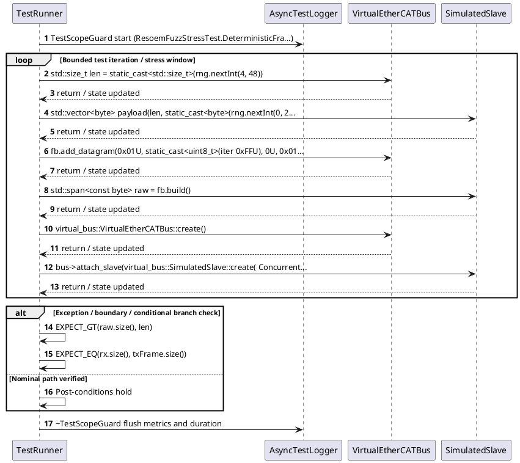

# Test Case: `ResoemFuzzStressTest.DeterministicFrameFuzzAndConcurrentVirtualBusStress`

| Property | Value |
| :--- | :--- |
| **Module** | `resoem` |
| **Source File** | `cmake-projects/resoem/test_cs0100/TestResoemExtended.cpp` (lines 153–206) |
| **Category** | Determinism, Fuzzing, Concurrency & Stress (`CS-0100.7`, `CS-0100.10`, `CS-0100.11`, `CS-0100.12`) |
| **Traceability** | `[TSK-20260920-001]`, `[FE-0040]`, `[CS-0010.37]`, `[FE-0040.8]` |
| **Async Telemetry** | Enabled (`TestScopeGuard` + `AsyncTestLogger`) |

## Summary

Extended CS-0100 test suite for `resoem` virtual EtherCAT bus, frame builder, ENI parser, fault injection, and concurrency.

## Sequence Diagram

## Observed Operations

- `std::size_t len = static_cast<std::size_t>(rng.nextInt(4, 48))`
- `std::vector<byte> payload(len, static_cast<byte>(rng.nextInt(0, 255)))`
- `fb.add_datagram(0x01U, static_cast<uint8_t>(iter & 0xFFU), 0U, 0x0100U, payload)`
- `std::span<const byte> raw = fb.build()`
- `virtual_bus::VirtualEtherCATBus::create()`
- `bus->attach_slave(virtual_bus::SimulatedSlave::create("ConcurrentSlave"))`
- `req.add_datagram(0x01U, 0U, 0U, 0x0130U, zeros)`
- `std::vector<byte> txFrame(req.build().begin(), req.build().end())`

## Verification Assertions

- `EXPECT_GT(raw.size(), len)`
- `EXPECT_EQ(rx.size(), txFrame.size())`

---

[Back to `resoem` Tests Overview](../resoem.md)
