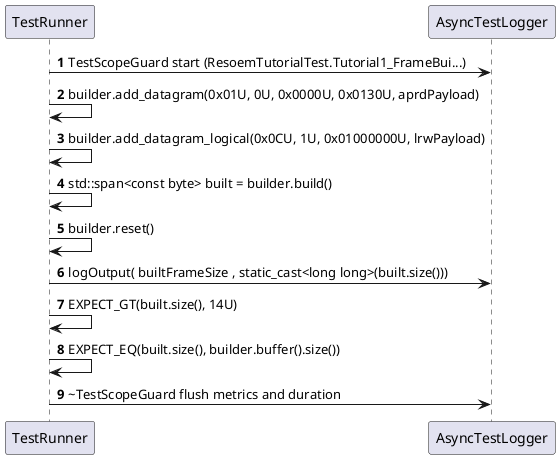

# Test Case: `ResoemTutorialTest.Tutorial1_FrameBuilderMultiDatagramConstruction`

| Property | Value |
| :--- | :--- |
| **Module** | `resoem` |
| **Source File** | `cmake-projects/resoem/test_cs0100/TestResoemExtended.cpp` (lines 57–72) |
| **Category** | Pedagogical Tutorial (`CS-0100.19`) |
| **Traceability** | `[TSK-20260920-001]`, `[FE-0040]`, `[CS-0010.37]`, `[FE-0040.8]` |
| **Async Telemetry** | Enabled (`TestScopeGuard` + `AsyncTestLogger`) |

## Summary

Extended CS-0100 test suite for `resoem` virtual EtherCAT bus, frame builder, ENI parser, fault injection, and concurrency.

## Sequence Diagram

## Observed Operations

- `builder.add_datagram(0x01U, 0U, 0x0000U, 0x0130U, aprdPayload)`
- `builder.add_datagram_logical(0x0CU, 1U, 0x01000000U, lrwPayload)`
- `std::span<const byte> built = builder.build()`
- `builder.reset()`
- `logOutput("builtFrameSize", static_cast<long long>(built.size()))`

## Verification Assertions

- `EXPECT_GT(built.size(), 14U)`
- `EXPECT_EQ(built.size(), builder.buffer().size())`

---

[Back to `resoem` Tests Overview](../resoem.md)
