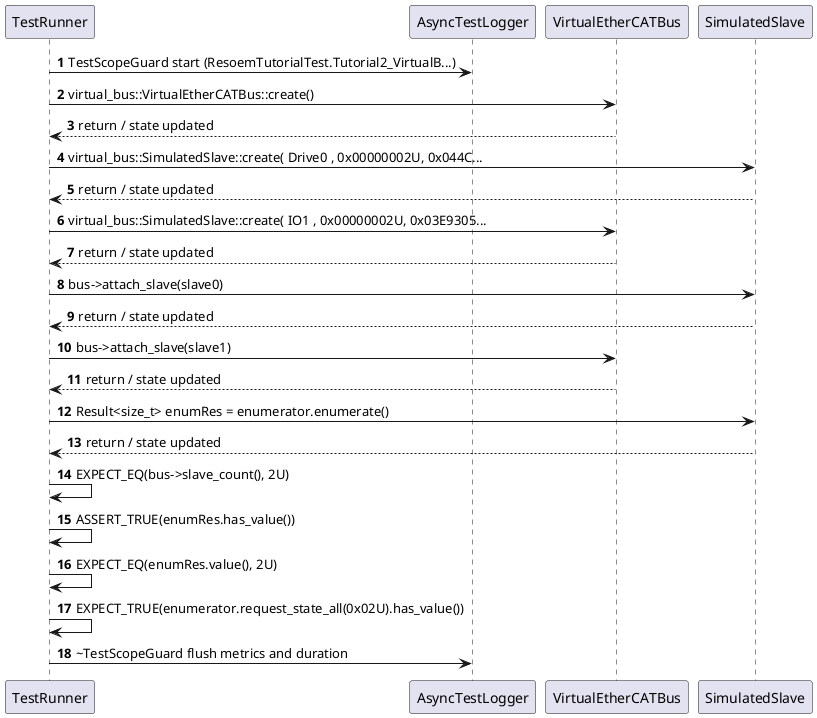

# Test Case: `ResoemTutorialTest.Tutorial2_VirtualBusEnumerationAndStateTransitions`

| Property | Value |
| :--- | :--- |
| **Module** | `resoem` |
| **Source File** | `cmake-projects/resoem/test_cs0100/TestResoemExtended.cpp` (lines 74–99) |
| **Category** | Pedagogical Tutorial (`CS-0100.19`) |
| **Traceability** | `[TSK-20260920-001]`, `[FE-0040]`, `[CS-0010.37]`, `[FE-0040.8]` |
| **Async Telemetry** | Enabled (`TestScopeGuard` + `AsyncTestLogger`) |

## Summary

Extended CS-0100 test suite for `resoem` virtual EtherCAT bus, frame builder, ENI parser, fault injection, and concurrency.

## Sequence Diagram

## Observed Operations

- `virtual_bus::VirtualEtherCATBus::create()`
- `virtual_bus::SimulatedSlave::create("Drive0", 0x00000002U, 0x044C2C52U, 0x00100000U, 1U)`
- `virtual_bus::SimulatedSlave::create("IO1", 0x00000002U, 0x03E93052U, 0x00100000U, 2U)`
- `bus->attach_slave(slave0)`
- `bus->attach_slave(slave1)`
- `Result<size_t> enumRes = enumerator.enumerate()`
- `logOutput("slavesInOp", static_cast<long long>(bus->slave_count()))`

## Verification Assertions

- `EXPECT_EQ(bus->slave_count(), 2U)`
- `ASSERT_TRUE(enumRes.has_value())`
- `EXPECT_EQ(enumRes.value(), 2U)`
- `EXPECT_TRUE(enumerator.request_state_all(0x02U).has_value())`
- `EXPECT_TRUE(enumerator.request_state_all(0x04U).has_value())`
- `EXPECT_TRUE(enumerator.request_state_all(0x08U).has_value())`

---

[Back to `resoem` Tests Overview](../resoem.md)
