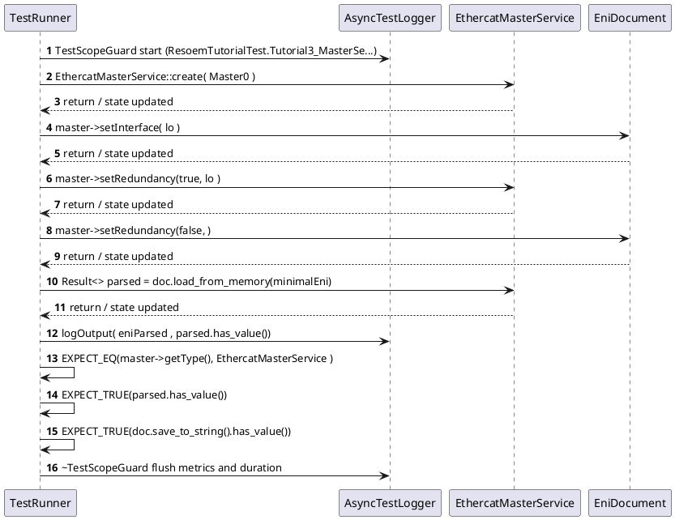

# Test Case: `ResoemTutorialTest.Tutorial3_MasterServiceConfigAndEniDocumentParsing`

| Property | Value |
| :--- | :--- |
| **Module** | `resoem` |
| **Source File** | `cmake-projects/resoem/test_cs0100/TestResoemExtended.cpp` (lines 101–119) |
| **Category** | Pedagogical Tutorial (`CS-0100.19`) |
| **Traceability** | `[TSK-20260920-001]`, `[FE-0040]`, `[CS-0010.37]`, `[FE-0040.8]` |
| **Async Telemetry** | Enabled (`TestScopeGuard` + `AsyncTestLogger`) |

## Summary

Extended CS-0100 test suite for `resoem` virtual EtherCAT bus, frame builder, ENI parser, fault injection, and concurrency.

## Sequence Diagram

## Observed Operations

- `EthercatMasterService::create("Master0")`
- `master->setInterface("lo")`
- `master->setRedundancy(true, "lo")`
- `master->setRedundancy(false, "")`
- `Result<> parsed = doc.load_from_memory(minimalEni)`
- `logOutput("eniParsed", parsed.has_value())`

## Verification Assertions

- `EXPECT_EQ(master->getType(), "EthercatMasterService")`
- `EXPECT_TRUE(parsed.has_value())`
- `EXPECT_TRUE(doc.save_to_string().has_value())`

---

[Back to `resoem` Tests Overview](../resoem.md)
