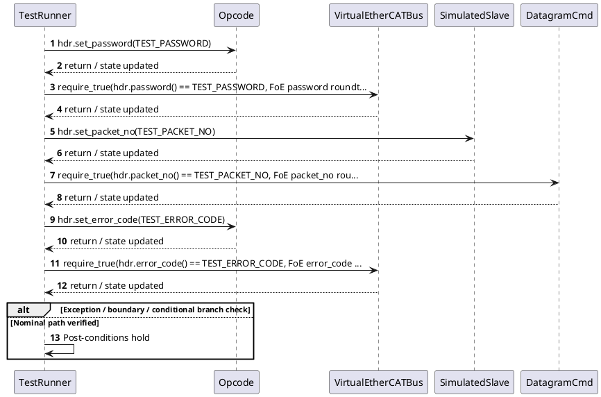

# Test Case: `resoem_compliance_and_stress`

| Property | Value |
| :--- | :--- |
| **Module** | `resoem` |
| **Source File** | `cmake-projects/resoem/test/test_compliance_and_stress.cpp` (lines 1–381) |
| **Category** | Unit & Regression Verification |
| **Traceability** | `[TSK-20261113-002]` |
| **Async Telemetry** | Standard GTest / CTest stdout |

## Summary

Stress, concurrency, and C++23 compliance verification tests for resoem.

## Sequence Diagram

## Observed Operations

- `hdr.set_password(TEST_PASSWORD)`
- `require_true(hdr.password() == TEST_PASSWORD, "FoE password roundtrip failed")`
- `hdr.set_packet_no(TEST_PACKET_NO)`
- `require_true(hdr.packet_no() == TEST_PACKET_NO, "FoE packet_no roundtrip failed")`
- `hdr.set_error_code(TEST_ERROR_CODE)`
- `require_true(hdr.error_code() == TEST_ERROR_CODE, "FoE error_code roundtrip failed")`
- `std::memcpy(wire.data(), &hdr, wire.size())`
- `resoem::virtual_bus::VirtualEtherCATBus::create()`

## Verification Assertions

- Verified via exit status `0` and runtime checks inside executable.

---

[Back to `resoem` Tests Overview](../resoem.md)
