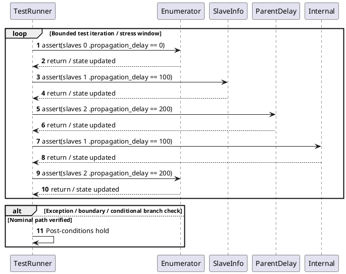

# Test Case: `resoem_dc_calc`

| Property | Value |
| :--- | :--- |
| **Module** | `resoem` |
| **Source File** | `cmake-projects/resoem/test/test_dc_calc.cpp` (lines 1–188) |
| **Category** | Unit & Regression Verification |
| **Traceability** | See module specification (`FE-*` / `TSK-*`) |
| **Async Telemetry** | Standard GTest / CTest stdout |

## Summary

Executes verification scenario `resoem_dc_calc` defined in `cmake-projects/resoem/test/test_dc_calc.cpp`.

## Sequence Diagram

## Observed Operations

- `assert(slaves[0].propagation_delay == 0)`
- `assert(slaves[1].propagation_delay == 100)`
- `assert(slaves[2].propagation_delay == 200)`
- `assert(slaves[1].propagation_delay == 100)`
- `assert(slaves[2].propagation_delay == 200)`

## Verification Assertions

- Verified via exit status `0` and runtime checks inside executable.

---

[Back to `resoem` Tests Overview](../resoem.md)
