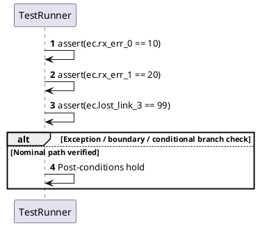

# Test Case: `resoem_diagnostics`

| Property | Value |
| :--- | :--- |
| **Module** | `resoem` |
| **Source File** | `cmake-projects/resoem/test/test_diagnostics.cpp` (lines 1–73) |
| **Category** | Unit & Regression Verification |
| **Traceability** | See module specification (`FE-*` / `TSK-*`) |
| **Async Telemetry** | Standard GTest / CTest stdout |

## Summary

Executes verification scenario `resoem_diagnostics` defined in `cmake-projects/resoem/test/test_diagnostics.cpp`.

## Sequence Diagram

## Observed Operations

- `assert(ec.rx_err_0 == 10)`
- `assert(ec.rx_err_1 == 20)`
- `assert(ec.lost_link_3 == 99)`

## Verification Assertions

- Verified via exit status `0` and runtime checks inside executable.

---

[Back to `resoem` Tests Overview](../resoem.md)
