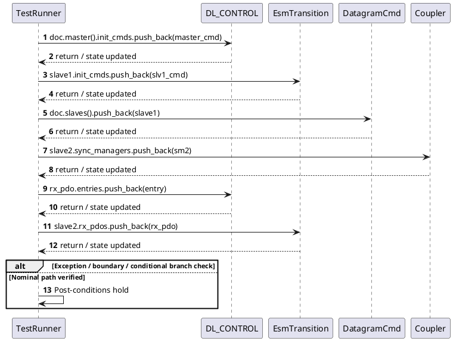

# Test Case: `resoem_eni_configurator`

| Property | Value |
| :--- | :--- |
| **Module** | `resoem` |
| **Source File** | `cmake-projects/resoem/test/test_eni_configurator.cpp` (lines 1–213) |
| **Category** | Unit & Regression Verification |
| **Traceability** | See module specification (`FE-*` / `TSK-*`) |
| **Async Telemetry** | Standard GTest / CTest stdout |

## Summary

Unit test verifying EniConfigurator network initialization and validation engine.

## Sequence Diagram

## Observed Operations

- `doc.master().init_cmds.push_back(master_cmd)`
- `slave1.init_cmds.push_back(slv1_cmd)`
- `doc.slaves().push_back(slave1)`
- `slave2.sync_managers.push_back(sm2)`
- `rx_pdo.entries.push_back(entry)`
- `slave2.rx_pdos.push_back(rx_pdo)`
- `doc.slaves().push_back(slave2)`
- `frame.commands.push_back(cyc_cmd)`

## Verification Assertions

- Verified via exit status `0` and runtime checks inside executable.

---

[Back to `resoem` Tests Overview](../resoem.md)
