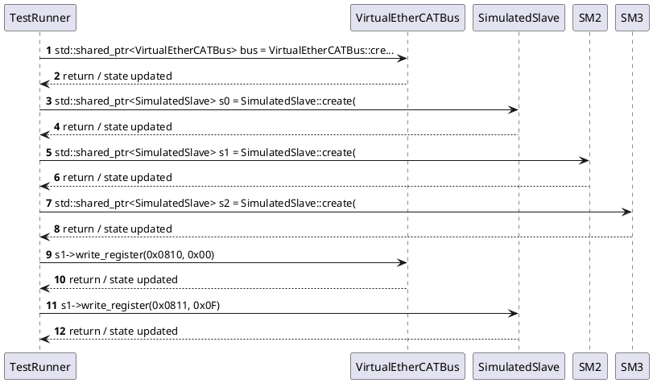

# Test Case: `resoem_eni_generator_comparator`

| Property | Value |
| :--- | :--- |
| **Module** | `resoem` |
| **Source File** | `cmake-projects/resoem/test/test_eni_generator_comparator.cpp` (lines 1–181) |
| **Category** | Unit & Regression Verification |
| **Traceability** | See module specification (`FE-*` / `TSK-*`) |
| **Async Telemetry** | Standard GTest / CTest stdout |

## Summary

Unit tests for EniGenerator and EniComparator engines.

## Sequence Diagram

## Observed Operations

- `std::shared_ptr<VirtualEtherCATBus> bus = VirtualEtherCATBus::create()`
- `std::shared_ptr<SimulatedSlave> s0 = SimulatedSlave::create(`
- `std::shared_ptr<SimulatedSlave> s1 = SimulatedSlave::create(`
- `std::shared_ptr<SimulatedSlave> s2 = SimulatedSlave::create(`
- `s1->write_register(0x0810, 0x00)`
- `s1->write_register(0x0811, 0x0F)`
- `s1->write_register(0x0812, 0x01)`
- `s1->write_register(0x0813, 0x00)`

## Verification Assertions

- Verified via exit status `0` and runtime checks inside executable.

---

[Back to `resoem` Tests Overview](../resoem.md)
