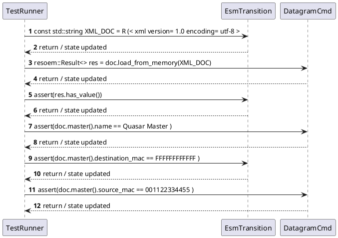

# Test Case: `resoem_eni_parser`

| Property | Value |
| :--- | :--- |
| **Module** | `resoem` |
| **Source File** | `cmake-projects/resoem/test/test_eni_parser.cpp` (lines 1–400) |
| **Category** | Unit & Regression Verification |
| **Traceability** | See module specification (`FE-*` / `TSK-*`) |
| **Async Telemetry** | Standard GTest / CTest stdout |

## Summary

Unit tests for ETG.2100 EniDocument parser, serializer, and NamedObject bridge.

## Sequence Diagram

## Observed Operations

- `const std::string XML_DOC = R"(<?xml version="1.0" encoding="utf-8"?>`
- `resoem::Result<> res = doc.load_from_memory(XML_DOC)`
- `assert(res.has_value())`
- `assert(doc.master().name == "Quasar Master")`
- `assert(doc.master().destination_mac == "FFFFFFFFFFFF")`
- `assert(doc.master().source_mac == "001122334455")`
- `assert(doc.master().init_cmds.size() == 1)`
- `assert(doc.master().init_cmds[0].transition == EsmTransition::IP)`

## Verification Assertions

- Verified via exit status `0` and runtime checks inside executable.

---

[Back to `resoem` Tests Overview](../resoem.md)
