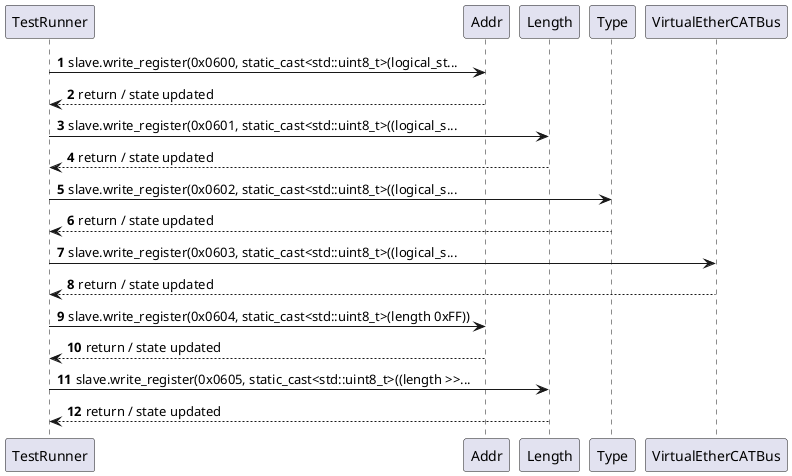

# Test Case: `resoem_redundancy_loop`

| Property | Value |
| :--- | :--- |
| **Module** | `resoem` |
| **Source File** | `cmake-projects/resoem/test/test_redundancy_loop.cpp` (lines 1–296) |
| **Category** | Unit & Regression Verification |
| **Traceability** | See module specification (`FE-*` / `TSK-*`) |
| **Async Telemetry** | Standard GTest / CTest stdout |

## Summary

Unit and integration tests for EtherCAT Cable Redundancy loop topology engine.

## Sequence Diagram

## Observed Operations

- `slave.write_register(0x0600, static_cast<std::uint8_t>(logical_start & 0xFF))`
- `slave.write_register(0x0601, static_cast<std::uint8_t>((logical_start >> 8) & 0xFF))`
- `slave.write_register(0x0602, static_cast<std::uint8_t>((logical_start >> 16) & 0xFF))`
- `slave.write_register(0x0603, static_cast<std::uint8_t>((logical_start >> 24) & 0xFF))`
- `slave.write_register(0x0604, static_cast<std::uint8_t>(length & 0xFF))`
- `slave.write_register(0x0605, static_cast<std::uint8_t>((length >> 8) & 0xFF))`
- `slave.write_register(0x0606, 0)`
- `slave.write_register(0x0607, 7)`

## Verification Assertions

- Verified via exit status `0` and runtime checks inside executable.

---

[Back to `resoem` Tests Overview](../resoem.md)
