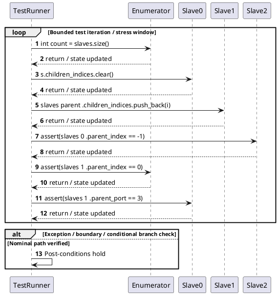

# Test Case: `resoem_topology`

| Property | Value |
| :--- | :--- |
| **Module** | `resoem` |
| **Source File** | `cmake-projects/resoem/test/test_topology.cpp` (lines 1–189) |
| **Category** | Unit & Regression Verification |
| **Traceability** | See module specification (`FE-*` / `TSK-*`) |
| **Async Telemetry** | Standard GTest / CTest stdout |

## Summary

Executes verification scenario `resoem_topology` defined in `cmake-projects/resoem/test/test_topology.cpp`.

## Sequence Diagram

## Observed Operations

- `int count = slaves.size()`
- `s.children_indices.clear()`
- `slaves[parent].children_indices.push_back(i)`
- `assert(slaves[0].parent_index == -1)`
- `assert(slaves[1].parent_index == 0)`
- `assert(slaves[1].parent_port == 3)`
- `assert(slaves[2].parent_index == 1)`
- `assert(slaves[2].parent_port == 3)`

## Verification Assertions

- Verified via exit status `0` and runtime checks inside executable.

---

[Back to `resoem` Tests Overview](../resoem.md)
