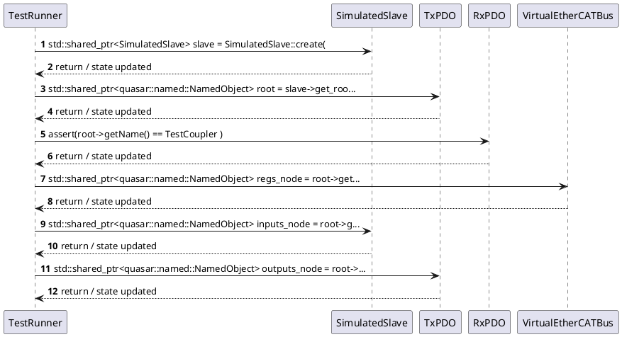

# Test Case: `resoem_virtual_bus`

| Property | Value |
| :--- | :--- |
| **Module** | `resoem` |
| **Source File** | `cmake-projects/resoem/test/test_virtual_bus.cpp` (lines 1–178) |
| **Category** | Unit & Regression Verification |
| **Traceability** | See module specification (`FE-*` / `TSK-*`) |
| **Async Telemetry** | Standard GTest / CTest stdout |

## Summary

Unit test verifying SimulatedSlave, VirtualEtherCATBus, and StubRawSocket.

## Sequence Diagram

## Observed Operations

- `std::shared_ptr<SimulatedSlave> slave = SimulatedSlave::create(`
- `std::shared_ptr<quasar::named::NamedObject> root = slave->get_root_node()`
- `assert(root->getName() == "TestCoupler")`
- `std::shared_ptr<quasar::named::NamedObject> regs_node = root->getChild("Registers")`
- `std::shared_ptr<quasar::named::NamedObject> inputs_node = root->getChild("Inputs")`
- `std::shared_ptr<quasar::named::NamedObject> outputs_node = root->getChild("Outputs")`
- `std::shared_ptr<quasar::named::NamedObject> al_status_obj = regs_node->getChild("AL_Status")`
- `assert(al_status_node->getValue() == states::INIT)`

## Verification Assertions

- Verified via exit status `0` and runtime checks inside executable.

---

[Back to `resoem` Tests Overview](../resoem.md)
