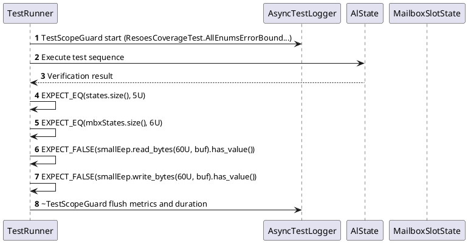

# Test Case: `ResoesCoverageTest.AllEnumsErrorBoundariesAndMailboxSlotStates`

| Property | Value |
| :--- | :--- |
| **Module** | `resoes` |
| **Source File** | `cmake-projects/resoes/test_cs0100/TestResoesExtended.cpp` (lines 168–197) |
| **Category** | Coverage, Enum, Boundary & Exception Containment (`CS-0100.1`, `CS-0100.3`, `CS-0100.4`, `CS-0100.6`, `CS-0100.9`) |
| **Traceability** | `[TSK-20261113-001]`, `[FE-0280]`, `[CS-0010.37]` |
| **Async Telemetry** | Enabled (`TestScopeGuard` + `AsyncTestLogger`) |

## Summary

Extended CS-0100 test suite for `resoes` EtherCAT SubDevice stack.

## Sequence Diagram

## Observed Operations

- Invokes standalone executable entry flow.

## Verification Assertions

- `EXPECT_EQ(states.size(), 5U)`
- `EXPECT_EQ(mbxStates.size(), 6U)`
- `EXPECT_FALSE(smallEep.read_bytes(60U, buf).has_value())`
- `EXPECT_FALSE(smallEep.write_bytes(60U, buf).has_value())`
- `EXPECT_FALSE(od.read_bytes(0x9999U, 0U).has_value())`
- `EXPECT_FALSE(od.write_bytes(0x9999U, 0U, buf).has_value())`
- `EXPECT_FALSE(mbx.register_handler(nullptr).has_value())`

---

[Back to `resoes` Tests Overview](../resoes.md)
