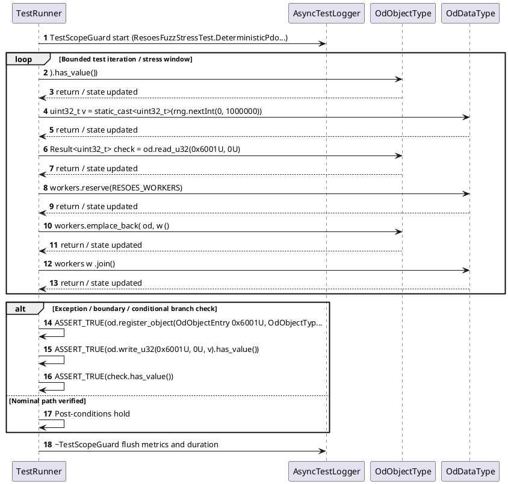

# Test Case: `ResoesFuzzStressTest.DeterministicPdoFuzzAndConcurrentOdAccess`

| Property | Value |
| :--- | :--- |
| **Module** | `resoes` |
| **Source File** | `cmake-projects/resoes/test_cs0100/TestResoesExtended.cpp` (lines 199–246) |
| **Category** | Determinism, Fuzzing, Concurrency & Stress (`CS-0100.7`, `CS-0100.10`, `CS-0100.11`, `CS-0100.12`) |
| **Traceability** | `[TSK-20261113-001]`, `[FE-0280]`, `[CS-0010.37]` |
| **Async Telemetry** | Enabled (`TestScopeGuard` + `AsyncTestLogger`) |

## Summary

Extended CS-0100 test suite for `resoes` EtherCAT SubDevice stack.

## Sequence Diagram

## Observed Operations

- `}}).has_value())`
- `uint32_t v = static_cast<uint32_t>(rng.nextInt(0, 1000000))`
- `Result<uint32_t> check = od.read_u32(0x6001U, 0U)`
- `workers.reserve(RESOES_WORKERS)`
- `workers.emplace_back([&od, w]() {`
- `workers[w].join()`

## Verification Assertions

- `ASSERT_TRUE(od.register_object(OdObjectEntry{0x6001U, OdObjectType::Var, 0U, "FuzzReg", {`
- `ASSERT_TRUE(od.write_u32(0x6001U, 0U, v).has_value())`
- `ASSERT_TRUE(check.has_value())`
- `EXPECT_EQ(check.value(), v)`
- `EXPECT_TRUE(od.write_u32(0x6001U, 0U, static_cast<uint32_t>((w * 1000U) + k)).has_value())`
- `EXPECT_TRUE(od.read_u32(0x6001U, 0U).has_value())`

---

[Back to `resoes` Tests Overview](../resoes.md)
