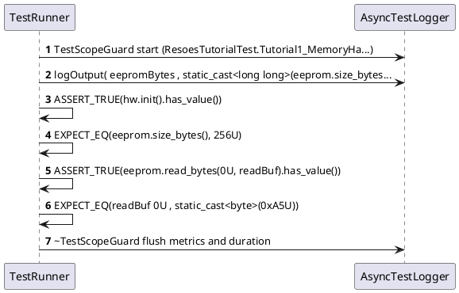

# Test Case: `ResoesTutorialTest.Tutorial1_MemoryHardwareAndEepromStorage`

| Property | Value |
| :--- | :--- |
| **Module** | `resoes` |
| **Source File** | `cmake-projects/resoes/test_cs0100/TestResoesExtended.cpp` (lines 76–98) |
| **Category** | Pedagogical Tutorial (`CS-0100.19`) |
| **Traceability** | `[TSK-20261113-001]`, `[FE-0280]`, `[CS-0010.37]` |
| **Async Telemetry** | Enabled (`TestScopeGuard` + `AsyncTestLogger`) |

## Summary

Extended CS-0100 test suite for `resoes` EtherCAT SubDevice stack.

## Sequence Diagram

## Observed Operations

- `logOutput("eepromBytes", static_cast<long long>(eeprom.size_bytes()))`

## Verification Assertions

- `ASSERT_TRUE(hw.init().has_value())`
- `EXPECT_EQ(eeprom.size_bytes(), 256U)`
- `ASSERT_TRUE(eeprom.read_bytes(0U, readBuf).has_value())`
- `EXPECT_EQ(readBuf[0U], static_cast<byte>(0xA5U))`
- `ASSERT_TRUE(eeprom.write_bytes(8U, patch).has_value())`
- `ASSERT_TRUE(eeprom.read_bytes(8U, readBuf).has_value())`
- `EXPECT_EQ(readBuf[0U], static_cast<byte>(0x11U))`

---

[Back to `resoes` Tests Overview](../resoes.md)
