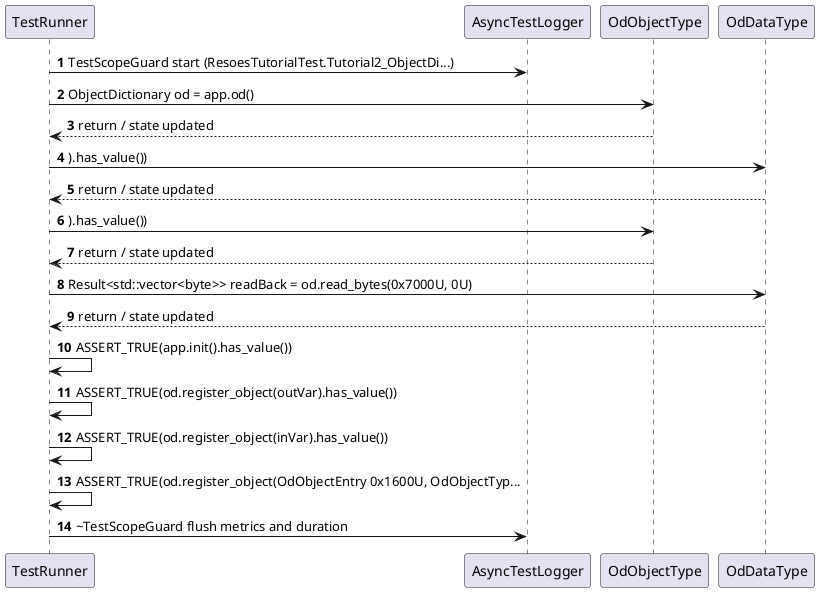

# Test Case: `ResoesTutorialTest.Tutorial2_ObjectDictionaryAndCoePdoPackUnpack`

| Property | Value |
| :--- | :--- |
| **Module** | `resoes` |
| **Source File** | `cmake-projects/resoes/test_cs0100/TestResoesExtended.cpp` (lines 100–148) |
| **Category** | Pedagogical Tutorial (`CS-0100.19`) |
| **Traceability** | `[TSK-20261113-001]`, `[FE-0280]`, `[CS-0010.37]` |
| **Async Telemetry** | Enabled (`TestScopeGuard` + `AsyncTestLogger`) |

## Summary

Extended CS-0100 test suite for `resoes` EtherCAT SubDevice stack.

## Sequence Diagram

## Observed Operations

- `ObjectDictionary& od = app.od()`
- `}}).has_value())`
- `}}).has_value())`
- `Result<std::vector<byte>> readBack = od.read_bytes(0x7000U, 0U)`

## Verification Assertions

- `ASSERT_TRUE(app.init().has_value())`
- `ASSERT_TRUE(od.register_object(outVar).has_value())`
- `ASSERT_TRUE(od.register_object(inVar).has_value())`
- `ASSERT_TRUE(od.register_object(OdObjectEntry{0x1600U, OdObjectType::Array, 1U, "RxPdoMap", {`
- `ASSERT_TRUE(od.register_object(OdObjectEntry{0x1C12U, OdObjectType::Array, 1U, "Sm2Assign", {`
- `ASSERT_TRUE(app.coe().compute_pdo_sizes_bytes(rxBytes, txBytes).has_value())`
- `EXPECT_EQ(rxBytes, 2U)`
- `ASSERT_TRUE(app.coe().unpack_rx_pdo(masterOut).has_value())`
- `ASSERT_TRUE(readBack.has_value())`
- `ASSERT_EQ(readBack.value().size(), 2U)`

---

[Back to `resoes` Tests Overview](../resoes.md)
