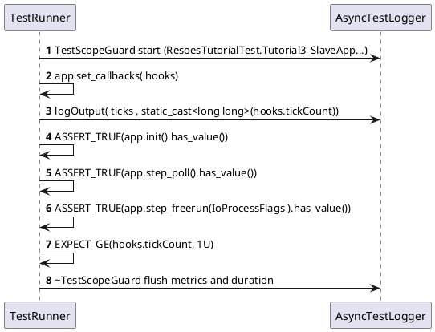

# Test Case: `ResoesTutorialTest.Tutorial3_SlaveApplicationFreerunAndCallbacks`

| Property | Value |
| :--- | :--- |
| **Module** | `resoes` |
| **Source File** | `cmake-projects/resoes/test_cs0100/TestResoesExtended.cpp` (lines 150–166) |
| **Category** | Pedagogical Tutorial (`CS-0100.19`) |
| **Traceability** | `[TSK-20261113-001]`, `[FE-0280]`, `[CS-0010.37]` |
| **Async Telemetry** | Enabled (`TestScopeGuard` + `AsyncTestLogger`) |

## Summary

Extended CS-0100 test suite for `resoes` EtherCAT SubDevice stack.

## Sequence Diagram

## Observed Operations

- `app.set_callbacks(&hooks)`
- `logOutput("ticks", static_cast<long long>(hooks.tickCount))`

## Verification Assertions

- `ASSERT_TRUE(app.init().has_value())`
- `ASSERT_TRUE(app.step_poll().has_value())`
- `ASSERT_TRUE(app.step_freerun(IoProcessFlags{}).has_value())`
- `EXPECT_GE(hooks.tickCount, 1U)`

---

[Back to `resoes` Tests Overview](../resoes.md)
