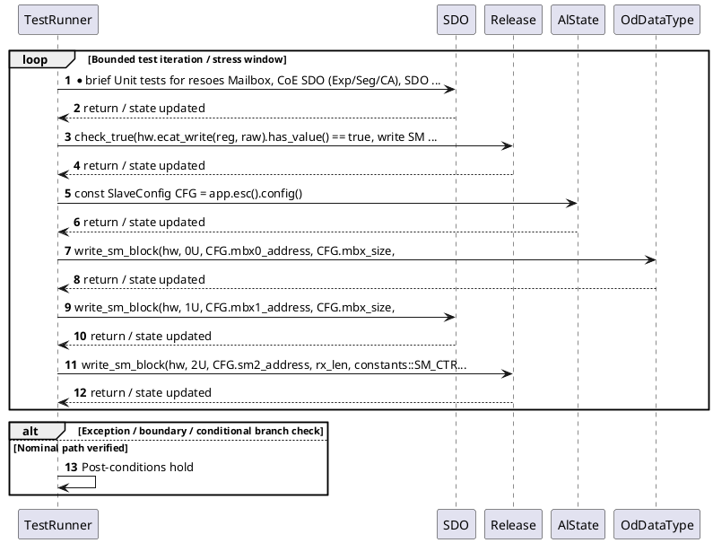

# Test Case: `resoes_coe_pdo`

| Property | Value |
| :--- | :--- |
| **Module** | `resoes` |
| **Source File** | `cmake-projects/resoes/test/test_coe_and_pdo.cpp` (lines 1–319) |
| **Category** | Unit & Regression Verification |
| **Traceability** | `[TSK-20261113-001]` |
| **Async Telemetry** | Standard GTest / CTest stdout |

## Summary

Unit tests for resoes Mailbox, CoE SDO (Exp/Seg/CA), SDO Info & Bit-Sliced PDOs.

## Sequence Diagram

## Observed Operations

- `* @brief Unit tests for resoes Mailbox, CoE SDO (Exp/Seg/CA), SDO Info & Bit-Sliced PDOs.`
- `check_true(hw.ecat_write(reg, raw).has_value() == true, "write SM block")`
- `const SlaveConfig &CFG = app.esc().config()`
- `write_sm_block(hw, 0U, CFG.mbx0_address, CFG.mbx_size,`
- `write_sm_block(hw, 1U, CFG.mbx1_address, CFG.mbx_size,`
- `write_sm_block(hw, 2U, CFG.sm2_address, rx_len, constants::SM_CTRL_DIR_WRITE)`
- `write_sm_block(hw, 3U, CFG.sm3_address, tx_len, constants::SM_CTRL_DIR_READ)`
- `check_true(hw.ecat_write_u16(constants::ESCREG_ALCONTROL, constants::AL_STATE_PREOP)`

## Verification Assertions

- Verified via exit status `0` and runtime checks inside executable.

---

[Back to `resoes` Tests Overview](../resoes.md)
