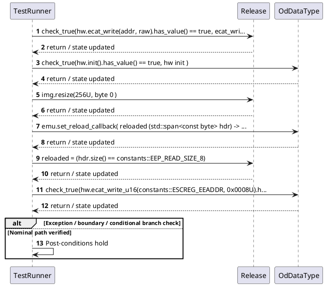

# Test Case: `resoes_esm_eeprom`

| Property | Value |
| :--- | :--- |
| **Module** | `resoes` |
| **Source File** | `cmake-projects/resoes/test/test_esm_and_eeprom.cpp` (lines 1–269) |
| **Category** | Unit & Regression Verification |
| **Traceability** | `[TSK-20261113-001]` |
| **Async Telemetry** | Standard GTest / CTest stdout |

## Summary

Hardware-free unit tests for resoes ESM transitions, Watchdog & SII EEPROM emulation.

## Sequence Diagram

## Observed Operations

- `check_true(hw.ecat_write(addr, raw).has_value() == true, "ecat_write SM")`
- `check_true(hw.init().has_value() == true, "hw init")`
- `img.resize(256U, byte{0})`
- `emu.set_reload_callback([&reloaded](std::span<const byte> hdr) -> Result<> {`
- `reloaded = (hdr.size() == constants::EEP_READ_SIZE_8)`
- `check_true(hw.ecat_write_u16(constants::ESCREG_EEADDR, 0x0008U).has_value(), "eeaddr")`
- `check_true(hw.ecat_write_u16(constants::ESCREG_EECONTSTAT, constants::EEP_CMD_READ)`
- `.has_value(), "ee read cmd")`

## Verification Assertions

- Verified via exit status `0` and runtime checks inside executable.

---

[Back to `resoes` Tests Overview](../resoes.md)
