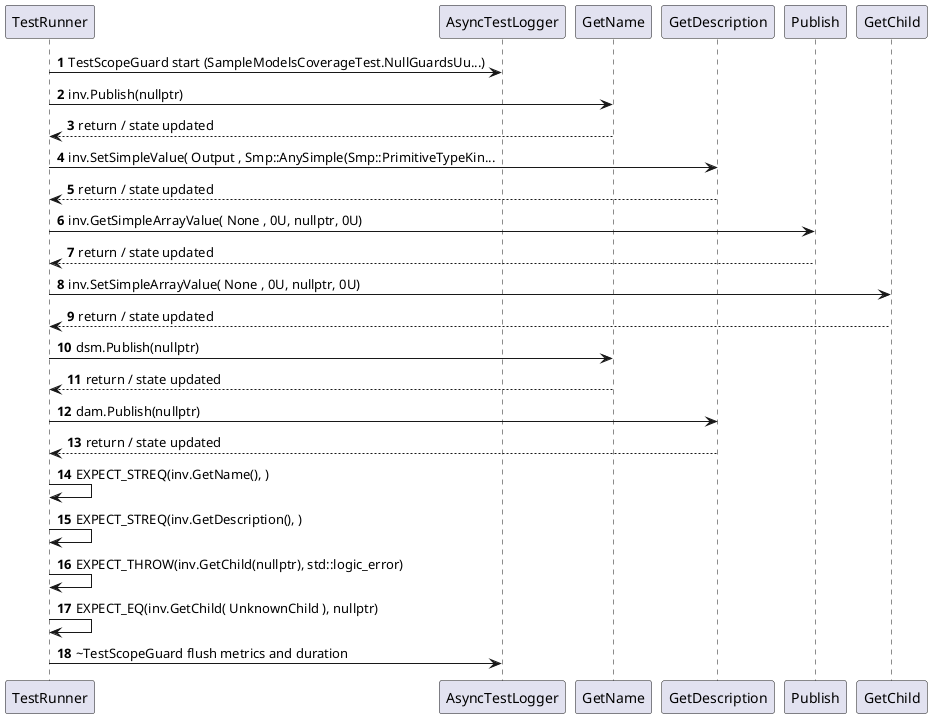

# Test Case: `SampleModelsCoverageTest.NullGuardsUuidsAndAllModelBranches`

| Property | Value |
| :--- | :--- |
| **Module** | `sample-models` |
| **Source File** | `cmake-projects/sample-models/test/TestSampleModels.cpp` (lines 364–396) |
| **Category** | Coverage, Enum, Boundary & Exception Containment (`CS-0100.1`, `CS-0100.3`, `CS-0100.4`, `CS-0100.6`, `CS-0100.9`) |
| **Traceability** | `TSK-20261113-004`, `FE-0020`, `CS-0090.1,` |
| **Async Telemetry** | Enabled (`TestScopeGuard` + `AsyncTestLogger`) |

## Summary

Verifies all null guards, UUIDs, fallbacks, and untouched base stubs on sample models.

## Sequence Diagram

## Observed Operations

- `inv.Publish(nullptr)`
- `inv.SetSimpleValue("Output", Smp::AnySimple(Smp::PrimitiveTypeKind::PTK_Bool, true))`
- `inv.GetSimpleArrayValue("None", 0U, nullptr, 0U)`
- `inv.SetSimpleArrayValue("None", 0U, nullptr, 0U)`
- `dsm.Publish(nullptr)`
- `dam.Publish(nullptr)`

## Verification Assertions

- `EXPECT_STREQ(inv.GetName(), "")`
- `EXPECT_STREQ(inv.GetDescription(), "")`
- `EXPECT_THROW(inv.GetChild(nullptr), std::logic_error)`
- `EXPECT_EQ(inv.GetChild("UnknownChild"), nullptr)`
- `EXPECT_EQ(inv.GetContainer("None"), nullptr)`
- `EXPECT_NE(inv.GetContainers(), nullptr)`
- `EXPECT_NE(inv.GetFields(), nullptr)`
- `EXPECT_EQ(static_cast<int>(inv.GetSimpleValue("Missing").type), static_cast<int>(Smp::PrimitiveTypeKind::PTK_None))`
- `EXPECT_FALSE(inv.AddChild(nullptr, nullptr))`
- `EXPECT_FALSE(inv.RemoveChild(nullptr, nullptr))`

---

[Back to `sample-models` Tests Overview](../sample-models.md)
