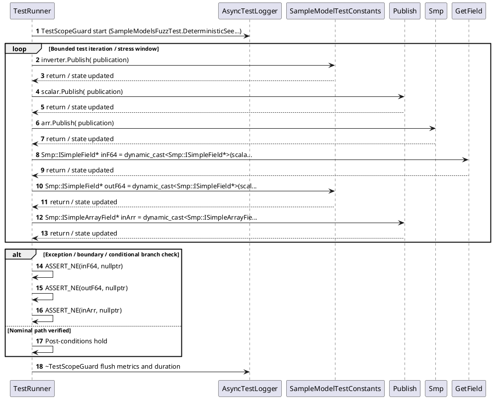

# Test Case: `SampleModelsFuzzTest.DeterministicSeededPipelineFuzzing`

| Property | Value |
| :--- | :--- |
| **Module** | `sample-models` |
| **Source File** | `cmake-projects/sample-models/test/TestSampleModels.cpp` (lines 405–458) |
| **Category** | Determinism, Fuzzing, Concurrency & Stress (`CS-0100.7`, `CS-0100.10`, `CS-0100.11`, `CS-0100.12`) |
| **Traceability** | `TSK-20261113-004`, `FE-0020`, `CS-0090.1,` |
| **Async Telemetry** | Enabled (`TestScopeGuard` + `AsyncTestLogger`) |

## Summary

Performs deterministic seeded fuzzing across `DelayedSimpleModel`, `DelayedArrayModel`, and `InverterModel`.

## Sequence Diagram

## Observed Operations

- `inverter.Publish(&publication)`
- `scalar.Publish(&publication)`
- `arr.Publish(&publication)`
- `Smp::ISimpleField* inF64 = dynamic_cast<Smp::ISimpleField*>(scalar.GetField("Input_Float64"))`
- `Smp::ISimpleField* outF64 = dynamic_cast<Smp::ISimpleField*>(scalar.GetField("Output_Float64"))`
- `Smp::ISimpleArrayField* inArr = dynamic_cast<Smp::ISimpleArrayField*>(arr.GetField("InputArray"))`
- `Smp::ISimpleArrayField* outArr = dynamic_cast<Smp::ISimpleArrayField*>(arr.GetField("OutputArray"))`
- `const bool bit = rng.nextInt(0, 1) != 0`

## Verification Assertions

- `ASSERT_NE(inF64, nullptr)`
- `ASSERT_NE(outF64, nullptr)`
- `ASSERT_NE(inArr, nullptr)`
- `ASSERT_NE(outArr, nullptr)`
- `EXPECT_EQ(static_cast<Smp::Bool>(inverter.GetSimpleValue("Output")), !bit)`
- `EXPECT_DOUBLE_EQ(static_cast<Smp::Float64>(outF64->GetValue()), hist2)`
- `EXPECT_EQ(static_cast<Smp::Int8>(outArr->GetValue(0U)), arrHist2)`

---

[Back to `sample-models` Tests Overview](../sample-models.md)
