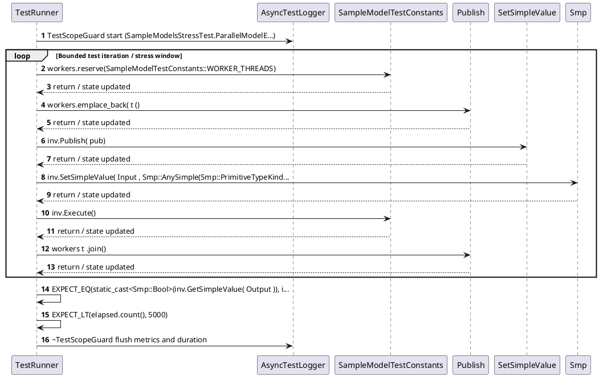

# Test Case: `SampleModelsStressTest.ParallelModelExecutionStress`

| Property | Value |
| :--- | :--- |
| **Module** | `sample-models` |
| **Source File** | `cmake-projects/sample-models/test/TestSampleModels.cpp` (lines 467–494) |
| **Category** | Determinism, Fuzzing, Concurrency & Stress (`CS-0100.7`, `CS-0100.10`, `CS-0100.11`, `CS-0100.12`) |
| **Traceability** | `TSK-20261113-004`, `FE-0020`, `CS-0090.1,` |
| **Async Telemetry** | Enabled (`TestScopeGuard` + `AsyncTestLogger`) |

## Summary

Exercises independent `InverterModel` instances in parallel threads for bounded duration.

## Sequence Diagram

## Observed Operations

- `workers.reserve(SampleModelTestConstants::WORKER_THREADS)`
- `workers.emplace_back([t]() {`
- `inv.Publish(&pub)`
- `inv.SetSimpleValue("Input", Smp::AnySimple(Smp::PrimitiveTypeKind::PTK_Bool, input))`
- `inv.Execute()`
- `workers[t].join()`

## Verification Assertions

- `EXPECT_EQ(static_cast<Smp::Bool>(inv.GetSimpleValue("Output")), !input)`
- `EXPECT_LT(elapsed.count(), 5000)`

---

[Back to `sample-models` Tests Overview](../sample-models.md)
