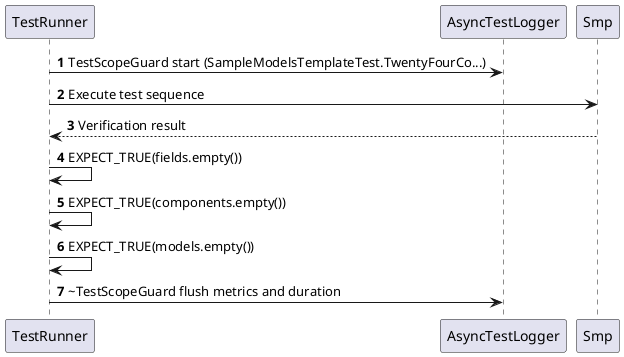

# Test Case: `SampleModelsTemplateTest.TwentyFourCollectionInstantiations`

| Property | Value |
| :--- | :--- |
| **Module** | `sample-models` |
| **Source File** | `cmake-projects/sample-models/test/TestSampleModels.cpp` (lines 325–355) |
| **Category** | Template / Polymorphic Breadth (`CS-0100.5`) |
| **Traceability** | `TSK-20261113-004`, `FE-0060`, `CS-0090.1,` |
| **Async Telemetry** | Enabled (`TestScopeGuard` + `AsyncTestLogger`) |

## Summary

Covers 24 distinct template instantiations of `sample::SimpleCollection<T>`.

## Sequence Diagram

## Observed Operations

- Invokes standalone executable entry flow.

## Verification Assertions

- `EXPECT_TRUE(fields.empty())`
- `EXPECT_TRUE(components.empty())`
- `EXPECT_TRUE(models.empty())`

---

[Back to `sample-models` Tests Overview](../sample-models.md)
