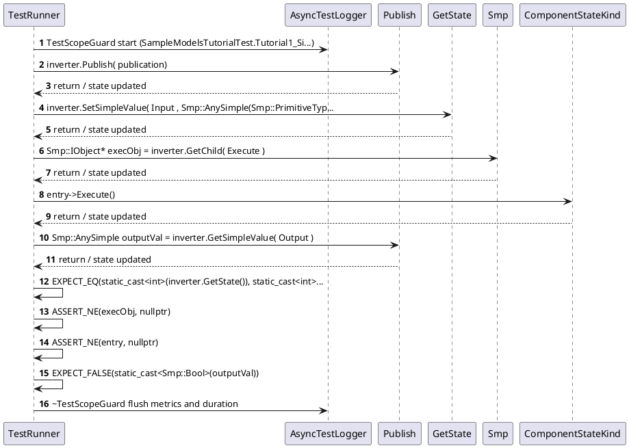

# Test Case: `SampleModelsTutorialTest.Tutorial1_SimpleInverterUsage`

| Property | Value |
| :--- | :--- |
| **Module** | `sample-models` |
| **Source File** | `cmake-projects/sample-models/test/TestSampleModels.cpp` (lines 220–241) |
| **Category** | Pedagogical Tutorial (`CS-0100.19`) |
| **Traceability** | `TSK-20261113-004`, `FE-0020`, `CS-0090.1,` |
| **Async Telemetry** | Enabled (`TestScopeGuard` + `AsyncTestLogger`) |

## Summary

Tutorial 1 (Basic): Publish and execute `InverterModel` boolean negation.

## Sequence Diagram

## Observed Operations

- `inverter.Publish(&publication)`
- `inverter.SetSimpleValue("Input", Smp::AnySimple(Smp::PrimitiveTypeKind::PTK_Bool, true))`
- `Smp::IObject* execObj = inverter.GetChild("Execute")`
- `entry->Execute()`
- `Smp::AnySimple outputVal = inverter.GetSimpleValue("Output")`

## Verification Assertions

- `EXPECT_EQ(static_cast<int>(inverter.GetState()), static_cast<int>(Smp::ComponentStateKind::CSK_Publishing))`
- `ASSERT_NE(execObj, nullptr)`
- `ASSERT_NE(entry, nullptr)`
- `EXPECT_FALSE(static_cast<Smp::Bool>(outputVal))`

---

[Back to `sample-models` Tests Overview](../sample-models.md)
