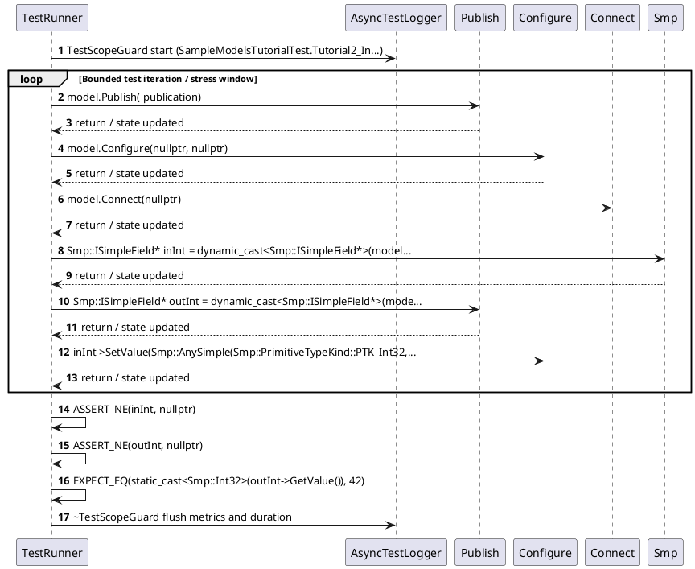

# Test Case: `SampleModelsTutorialTest.Tutorial2_IntermediateDelayedPipeline`

| Property | Value |
| :--- | :--- |
| **Module** | `sample-models` |
| **Source File** | `cmake-projects/sample-models/test/TestSampleModels.cpp` (lines 250–272) |
| **Category** | Pedagogical Tutorial (`CS-0100.19`) |
| **Traceability** | `TSK-20261113-004`, `FE-0020`, `CS-0090.1,` |
| **Async Telemetry** | Enabled (`TestScopeGuard` + `AsyncTestLogger`) |

## Summary

Tutorial 2 (Intermediate): Drive `DelayedSimpleModel` through its 3-step pipeline.

## Sequence Diagram

## Observed Operations

- `model.Publish(&publication)`
- `model.Configure(nullptr, nullptr)`
- `model.Connect(nullptr)`
- `Smp::ISimpleField* inInt = dynamic_cast<Smp::ISimpleField*>(model.GetField("Input_Int32"))`
- `Smp::ISimpleField* outInt = dynamic_cast<Smp::ISimpleField*>(model.GetField("Output_Int32"))`
- `inInt->SetValue(Smp::AnySimple(Smp::PrimitiveTypeKind::PTK_Int32, static_cast<Smp::Int32>(42)))`
- `model.Execute()`
- `quasar::test_support::AsyncTestLogger::instance().logEvent(`

## Verification Assertions

- `ASSERT_NE(inInt, nullptr)`
- `ASSERT_NE(outInt, nullptr)`
- `EXPECT_EQ(static_cast<Smp::Int32>(outInt->GetValue()), 42)`

---

[Back to `sample-models` Tests Overview](../sample-models.md)
