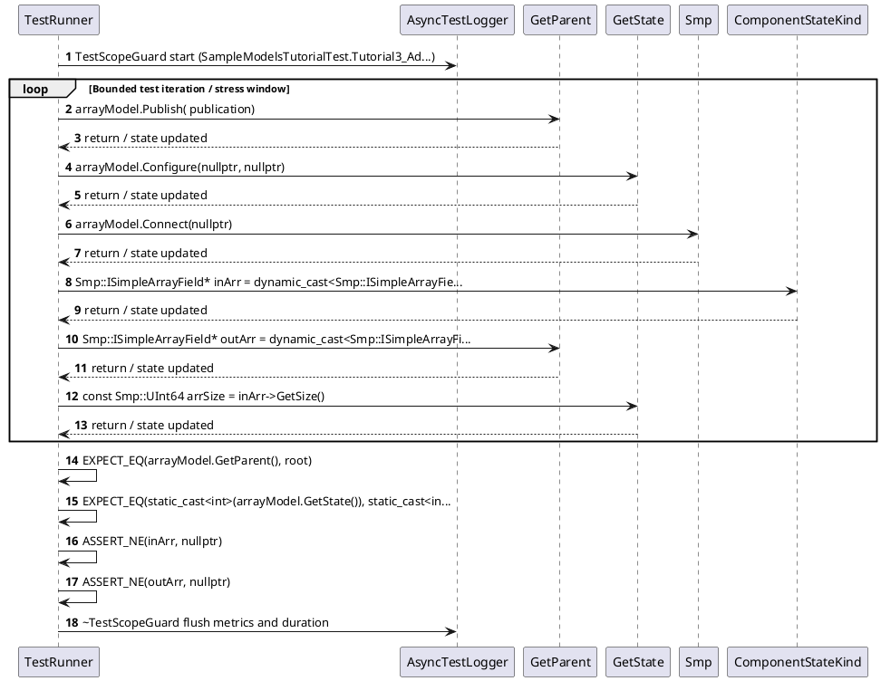

# Test Case: `SampleModelsTutorialTest.Tutorial3_AdvancedCompositeArrayAndLifecycle`

| Property | Value |
| :--- | :--- |
| **Module** | `sample-models` |
| **Source File** | `cmake-projects/sample-models/test/TestSampleModels.cpp` (lines 281–312) |
| **Category** | Pedagogical Tutorial (`CS-0100.19`) |
| **Traceability** | `TSK-20261113-004`, `FE-0020,`, `CS-0090.1,` |
| **Async Telemetry** | Enabled (`TestScopeGuard` + `AsyncTestLogger`) |

## Summary

Tutorial 3 (Advanced): Compose parent hierarchy, `DelayedArrayModel`, and lifecycle transitions.

## Sequence Diagram

## Observed Operations

- `arrayModel.Publish(&publication)`
- `arrayModel.Configure(nullptr, nullptr)`
- `arrayModel.Connect(nullptr)`
- `Smp::ISimpleArrayField* inArr = dynamic_cast<Smp::ISimpleArrayField*>(arrayModel.GetField("InputArray"))`
- `Smp::ISimpleArrayField* outArr = dynamic_cast<Smp::ISimpleArrayField*>(arrayModel.GetField("OutputArray"))`
- `const Smp::UInt64 arrSize = inArr->GetSize()`
- `inArr->SetValue(idx, Smp::AnySimple(Smp::PrimitiveTypeKind::PTK_Int8, static_cast<Smp::Int8>(idx + 10U)))`
- `arrayModel.Execute()`

## Verification Assertions

- `EXPECT_EQ(arrayModel.GetParent(), &root)`
- `EXPECT_EQ(static_cast<int>(arrayModel.GetState()), static_cast<int>(Smp::ComponentStateKind::CSK_Created))`
- `ASSERT_NE(inArr, nullptr)`
- `ASSERT_NE(outArr, nullptr)`
- `EXPECT_EQ(static_cast<Smp::Int8>(outArr->GetValue(0U)), 10)`
- `EXPECT_EQ(static_cast<Smp::Int8>(outArr->GetValue(9U)), 19)`
- `EXPECT_EQ(static_cast<int>(arrayModel.GetState()), static_cast<int>(Smp::ComponentStateKind::CSK_Disconnected))`

---

[Back to `sample-models` Tests Overview](../sample-models.md)
