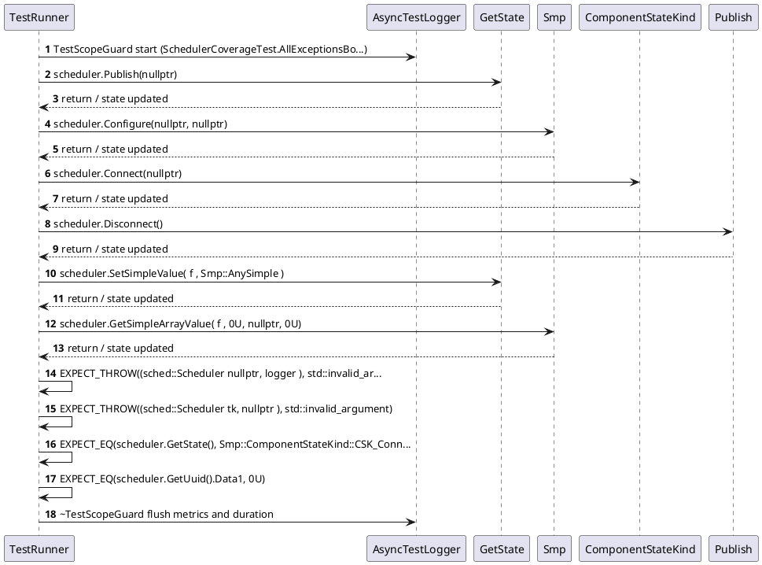

# Test Case: `SchedulerCoverageTest.AllExceptionsBoundariesAndStubs`

| Property | Value |
| :--- | :--- |
| **Module** | `sched` |
| **Source File** | `cmake-projects/sched/test/TestScheduler.cpp` (lines 226–314) |
| **Category** | Coverage, Enum, Boundary & Exception Containment (`CS-0100.1`, `CS-0100.3`, `CS-0100.4`, `CS-0100.6`, `CS-0100.9`) |
| **Traceability** | `TSK-20261113-004`, `FE-0070.3`, `CS-0090.1,` |
| **Async Telemetry** | Enabled (`TestScopeGuard` + `AsyncTestLogger`) |

## Summary

Covers all Scheduler exception sources, boundary inputs, and placeholder methods.

## Sequence Diagram

## Observed Operations

- `scheduler.Publish(nullptr)`
- `scheduler.Configure(nullptr, nullptr)`
- `scheduler.Connect(nullptr)`
- `scheduler.Disconnect()`
- `scheduler.SetSimpleValue("f", Smp::AnySimple{})`
- `scheduler.GetSimpleArrayValue("f", 0U, nullptr, 0U)`
- `scheduler.SetSimpleArrayValue("f", 0U, nullptr, 0U)`
- `const Smp::Services::EventId sim_id = scheduler.AddSimulationTimeEvent(&ep, 10LL, 0LL, 0LL)`

## Verification Assertions

- `EXPECT_THROW((sched::Scheduler{nullptr, &logger}), std::invalid_argument)`
- `EXPECT_THROW((sched::Scheduler{&tk, nullptr}), std::invalid_argument)`
- `EXPECT_EQ(scheduler.GetState(), Smp::ComponentStateKind::CSK_Connected)`
- `EXPECT_EQ(scheduler.GetUuid().Data1, 0U)`
- `EXPECT_EQ(scheduler.GetField("f"), nullptr)`
- `EXPECT_EQ(scheduler.GetFields(), nullptr)`
- `EXPECT_EQ(static_cast<int>(scheduler.GetSimpleValue("f").type),`
- `EXPECT_FALSE(scheduler.AddChild(nullptr, nullptr))`
- `EXPECT_FALSE(scheduler.RemoveChild(nullptr, nullptr))`
- `EXPECT_EQ(scheduler.IsChildInCollection(nullptr, nullptr), nullptr)`

---

[Back to `sched` Tests Overview](../sched.md)
