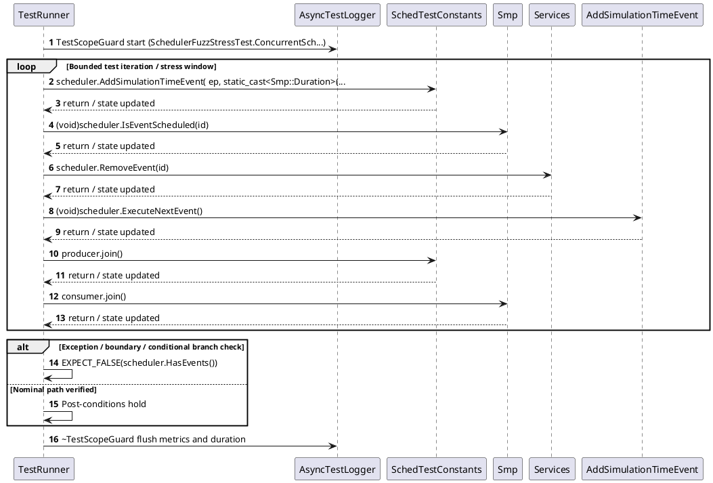

# Test Case: `SchedulerFuzzStressTest.ConcurrentScheduleCancelAndExecute`

| Property | Value |
| :--- | :--- |
| **Module** | `sched` |
| **Source File** | `cmake-projects/sched/test/TestScheduler.cpp` (lines 362–409) |
| **Category** | Determinism, Fuzzing, Concurrency & Stress (`CS-0100.7`, `CS-0100.10`, `CS-0100.11`, `CS-0100.12`) |
| **Traceability** | `TSK-20261113-004`, `FE-0070.3`, `CS-0010.37,` |
| **Async Telemetry** | Enabled (`TestScopeGuard` + `AsyncTestLogger`) |

## Summary

Concurrent producers scheduling/cancelling while consumer drains timeline safely.

## Sequence Diagram

## Observed Operations

- `scheduler.AddSimulationTimeEvent(&ep, static_cast<Smp::Duration>(idx + 1U), 0LL, 0LL)`
- `(void)scheduler.IsEventScheduled(id)`
- `scheduler.RemoveEvent(id)`
- `(void)scheduler.ExecuteNextEvent()`
- `producer.join()`
- `consumer.join()`
- `(void)scheduler.ExecuteNextEvent()`

## Verification Assertions

- `EXPECT_FALSE(scheduler.HasEvents())`

---

[Back to `sched` Tests Overview](../sched.md)
