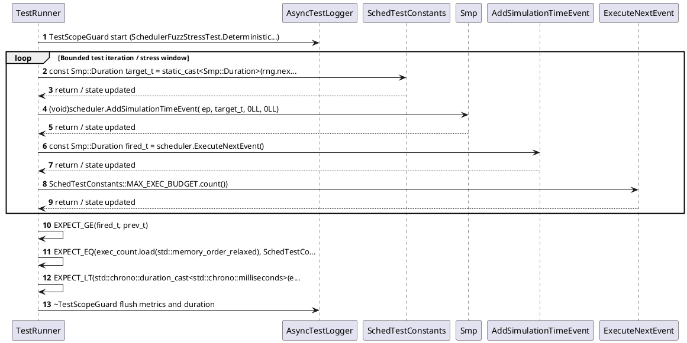

# Test Case: `SchedulerFuzzStressTest.DeterministicTimelineFuzzAndDurationBound`

| Property | Value |
| :--- | :--- |
| **Module** | `sched` |
| **Source File** | `cmake-projects/sched/test/TestScheduler.cpp` (lines 327–353) |
| **Category** | Determinism, Fuzzing, Concurrency & Stress (`CS-0100.7`, `CS-0100.10`, `CS-0100.11`, `CS-0100.12`) |
| **Traceability** | `TSK-20261113-004`, `FE-0070.3`, `CS-0010.37,` |
| **Async Telemetry** | Enabled (`TestScopeGuard` + `AsyncTestLogger`) |

## Summary

Deterministic seeded fuzzing of event timeline ordering and bounded execution time.

## Sequence Diagram

## Observed Operations

- `const Smp::Duration target_t = static_cast<Smp::Duration>(rng.nextInt(0, 10000))`
- `(void)scheduler.AddSimulationTimeEvent(&ep, target_t, 0LL, 0LL)`
- `const Smp::Duration fired_t = scheduler.ExecuteNextEvent()`
- `SchedTestConstants::MAX_EXEC_BUDGET.count())`

## Verification Assertions

- `EXPECT_GE(fired_t, prev_t)`
- `EXPECT_EQ(exec_count.load(std::memory_order_relaxed), SchedTestConstants::MAX_FUZZ_EVENTS)`
- `EXPECT_LT(std::chrono::duration_cast<std::chrono::milliseconds>(end_tp - start_tp).count(),`

---

[Back to `sched` Tests Overview](../sched.md)
