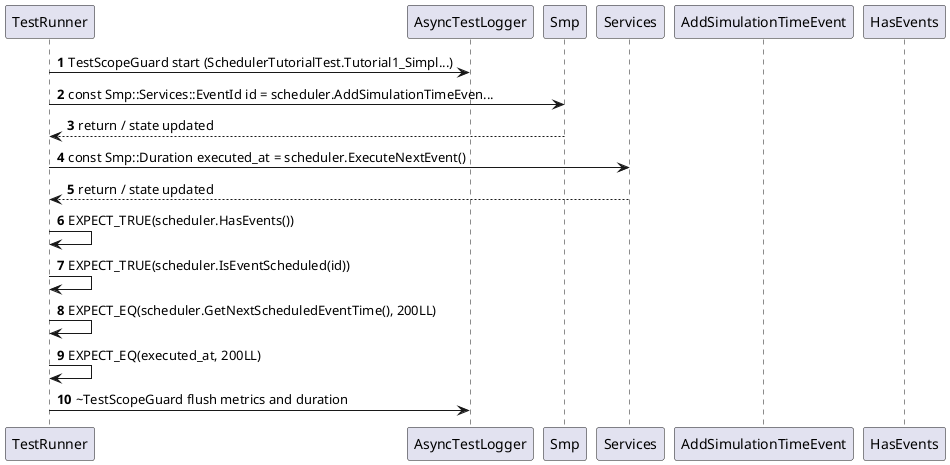

# Test Case: `SchedulerTutorialTest.Tutorial1_SimpleOneShotEvent`

| Property | Value |
| :--- | :--- |
| **Module** | `sched` |
| **Source File** | `cmake-projects/sched/test/TestScheduler.cpp` (lines 133–151) |
| **Category** | Pedagogical Tutorial (`CS-0100.19`) |
| **Traceability** | `TSK-20261113-004`, `FE-0070.3`, `CS-0090.1,` |
| **Async Telemetry** | Enabled (`TestScopeGuard` + `AsyncTestLogger`) |

## Summary

Tutorial 1 (Simple): Schedule and execute a one-shot simulation-time event.

## Sequence Diagram

## Observed Operations

- `const Smp::Services::EventId id = scheduler.AddSimulationTimeEvent(&ep, 200LL, 0LL, 0LL)`
- `const Smp::Duration executed_at = scheduler.ExecuteNextEvent()`

## Verification Assertions

- `EXPECT_TRUE(scheduler.HasEvents())`
- `EXPECT_TRUE(scheduler.IsEventScheduled(id))`
- `EXPECT_EQ(scheduler.GetNextScheduledEventTime(), 200LL)`
- `EXPECT_EQ(executed_at, 200LL)`
- `EXPECT_EQ(count.load(std::memory_order_relaxed), 1U)`
- `EXPECT_FALSE(scheduler.HasEvents())`
- `EXPECT_FALSE(scheduler.IsEventScheduled(id))`

---

[Back to `sched` Tests Overview](../sched.md)
