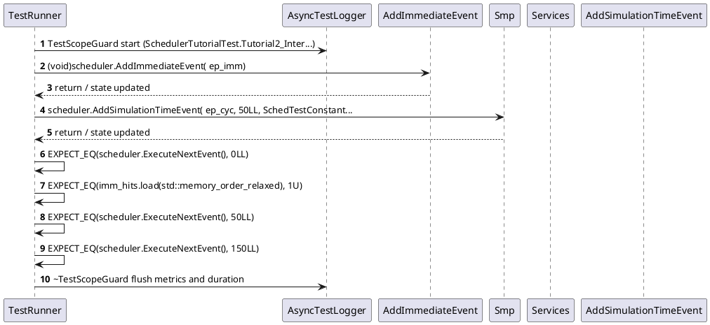

# Test Case: `SchedulerTutorialTest.Tutorial2_IntermediateCyclicAndImmediate`

| Property | Value |
| :--- | :--- |
| **Module** | `sched` |
| **Source File** | `cmake-projects/sched/test/TestScheduler.cpp` (lines 160–184) |
| **Category** | Pedagogical Tutorial (`CS-0100.19`) |
| **Traceability** | `TSK-20261113-004`, `FE-0070.3`, `CS-0090.1,` |
| **Async Telemetry** | Enabled (`TestScopeGuard` + `AsyncTestLogger`) |

## Summary

Tutorial 2 (Intermediate): Cyclic events, immediate events, and rescheduling.

## Sequence Diagram

## Observed Operations

- `(void)scheduler.AddImmediateEvent(&ep_imm)`
- `scheduler.AddSimulationTimeEvent(&ep_cyc, 50LL, SchedTestConstants::CYCLE_NS, 2LL)`

## Verification Assertions

- `EXPECT_EQ(scheduler.ExecuteNextEvent(), 0LL)`
- `EXPECT_EQ(imm_hits.load(std::memory_order_relaxed), 1U)`
- `EXPECT_EQ(scheduler.ExecuteNextEvent(), 50LL)`
- `EXPECT_EQ(scheduler.ExecuteNextEvent(), 150LL)`
- `EXPECT_EQ(scheduler.ExecuteNextEvent(), 250LL)`
- `EXPECT_EQ(cyc_hits.load(std::memory_order_relaxed), 3U)`
- `EXPECT_FALSE(scheduler.IsEventScheduled(cyc_id))`

---

[Back to `sched` Tests Overview](../sched.md)
