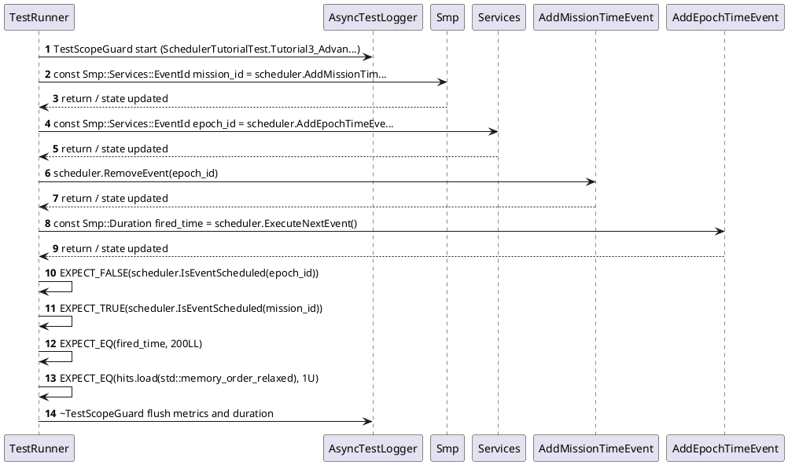

# Test Case: `SchedulerTutorialTest.Tutorial3_AdvancedMultiDomainAndCancel`

| Property | Value |
| :--- | :--- |
| **Module** | `sched` |
| **Source File** | `cmake-projects/sched/test/TestScheduler.cpp` (lines 193–213) |
| **Category** | Pedagogical Tutorial (`CS-0100.19`) |
| **Traceability** | `TSK-20261113-004`, `FE-0070.3`, `CS-0090.1,` |
| **Async Telemetry** | Enabled (`TestScopeGuard` + `AsyncTestLogger`) |

## Summary

Tutorial 3 (Advanced): Multi-domain scheduling (Mission/Epoch) and cancellation.

## Sequence Diagram

## Observed Operations

- `const Smp::Services::EventId mission_id = scheduler.AddMissionTimeEvent(&ep, 700LL, 0LL, 0LL)`
- `const Smp::Services::EventId epoch_id = scheduler.AddEpochTimeEvent(&ep, 1300LL, 0LL, 0LL)`
- `scheduler.RemoveEvent(epoch_id)`
- `const Smp::Duration fired_time = scheduler.ExecuteNextEvent()`

## Verification Assertions

- `EXPECT_FALSE(scheduler.IsEventScheduled(epoch_id))`
- `EXPECT_TRUE(scheduler.IsEventScheduled(mission_id))`
- `EXPECT_EQ(fired_time, 200LL)`
- `EXPECT_EQ(hits.load(std::memory_order_relaxed), 1U)`

---

[Back to `sched` Tests Overview](../sched.md)
