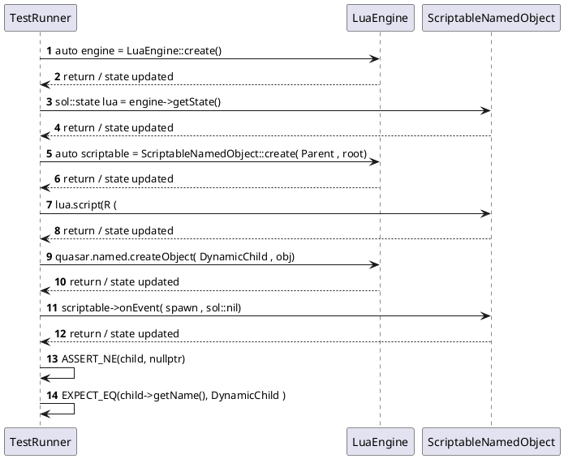

# Test Case: `ExtendableClassesTest.HookAddChild`

| Property | Value |
| :--- | :--- |
| **Module** | `scripting` |
| **Source File** | `cmake-projects/scripting/test/TestExtendableClasses.cpp` (lines 51–73) |
| **Category** | Unit & Regression Verification |
| **Traceability** | See module specification (`FE-*` / `TSK-*`) |
| **Async Telemetry** | Standard GTest / CTest stdout |

## Summary

Tests for C++ classes that can be extended with Lua logic.

## Sequence Diagram

## Observed Operations

- `auto engine = LuaEngine::create()`
- `sol::state& lua = engine->getState()`
- `auto scriptable = ScriptableNamedObject::create("Parent", root)`
- `lua.script(R"(`
- `quasar.named.createObject("DynamicChild", obj)`
- `scriptable->onEvent("spawn", sol::nil)`
- `auto child = scriptable->getChild("DynamicChild")`
- `engine->shutdown()`

## Verification Assertions

- `ASSERT_NE(child, nullptr)`
- `EXPECT_EQ(child->getName(), "DynamicChild")`

---

[Back to `scripting` Tests Overview](../scripting.md)
