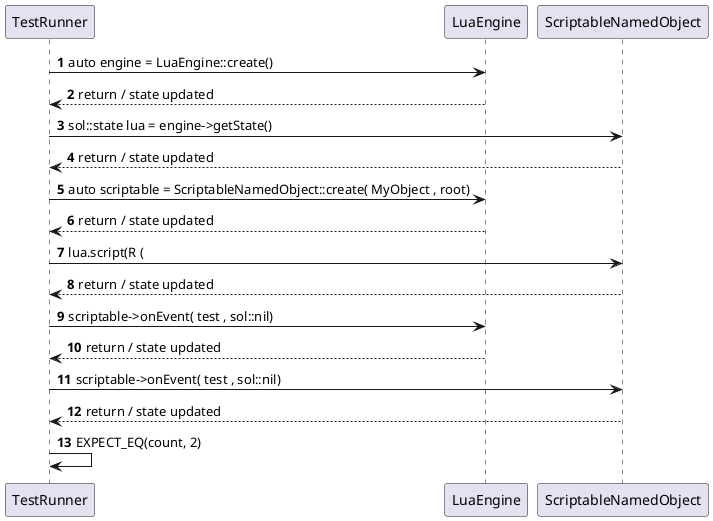

# Test Case: `ExtendableClassesTest.MethodOverride`

| Property | Value |
| :--- | :--- |
| **Module** | `scripting` |
| **Source File** | `cmake-projects/scripting/test/TestExtendableClasses.cpp` (lines 23–49) |
| **Category** | Unit & Regression Verification |
| **Traceability** | See module specification (`FE-*` / `TSK-*`) |
| **Async Telemetry** | Standard GTest / CTest stdout |

## Summary

Tests for C++ classes that can be extended with Lua logic.

## Sequence Diagram

## Observed Operations

- `auto engine = LuaEngine::create()`
- `sol::state& lua = engine->getState()`
- `auto scriptable = ScriptableNamedObject::create("MyObject", root)`
- `lua.script(R"(`
- `scriptable->onEvent("test", sol::nil)`
- `scriptable->onEvent("test", sol::nil)`
- `sol::table luaSelf = scriptable->getLuaSelf()`
- `engine->shutdown()`

## Verification Assertions

- `EXPECT_EQ(count, 2)`

---

[Back to `scripting` Tests Overview](../scripting.md)
