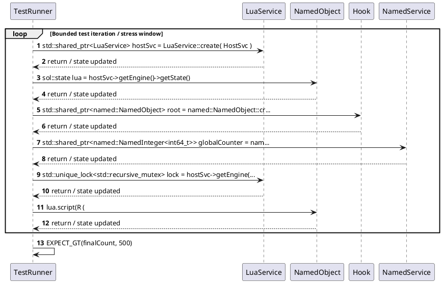

# Test Case: `IndustrialStressTest.HighConcurrencyLockContention`

| Property | Value |
| :--- | :--- |
| **Module** | `scripting` |
| **Source File** | `cmake-projects/scripting/test/TestIndustrialStress.cpp` (lines 18–76) |
| **Category** | Determinism, Fuzzing, Concurrency & Stress (`CS-0100.7`, `CS-0100.10`, `CS-0100.11`, `CS-0100.12`) |
| **Traceability** | See module specification (`FE-*` / `TSK-*`) |
| **Async Telemetry** | Standard GTest / CTest stdout |

## Summary

Industrial Stress Test: 50 concurrent services updating a shared tree.

## Sequence Diagram

## Observed Operations

- `std::shared_ptr<LuaService> hostSvc = LuaService::create("HostSvc")`
- `sol::state& lua = hostSvc->getEngine()->getState()`
- `std::shared_ptr<named::NamedObject> root = named::NamedObject::create("StressRoot")`
- `std::shared_ptr<named::NamedInteger<int64_t>> globalCounter = named::NamedInteger<int64_t>::create("GlobalCounter", 0, root)`
- `std::unique_lock<std::recursive_mutex> lock = hostSvc->getEngine()->acquireLock()`
- `lua.script(R"(`
- `std::unique_lock<std::recursive_mutex> lock = hostSvc->getEngine()->acquireLock()`
- `std::shared_ptr<named::NamedService> svc = named::NamedService::create("Service_" + std::to_string(i), root)`

## Verification Assertions

- `EXPECT_GT(finalCount, 500)`

---

[Back to `scripting` Tests Overview](../scripting.md)
