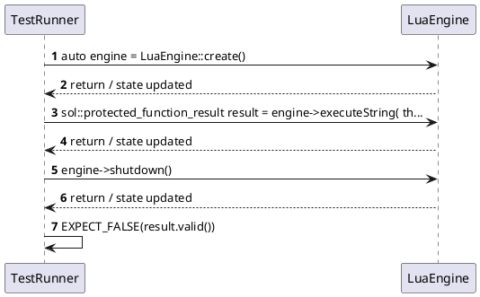

# Test Case: `LuaEngineTest.PanicHandling`

| Property | Value |
| :--- | :--- |
| **Module** | `scripting` |
| **Source File** | `cmake-projects/scripting/test/TestLuaEngine.cpp` (lines 58–64) |
| **Category** | Unit & Regression Verification |
| **Traceability** | See module specification (`FE-*` / `TSK-*`) |
| **Async Telemetry** | Standard GTest / CTest stdout |

## Summary

Executes verification scenario `LuaEngineTest.PanicHandling` defined in `cmake-projects/scripting/test/TestLuaEngine.cpp`.

## Sequence Diagram

## Observed Operations

- `auto engine = LuaEngine::create()`
- `sol::protected_function_result result = engine->executeString("this is not valid lua code $#%#$")`
- `engine->shutdown()`

## Verification Assertions

- `EXPECT_FALSE(result.valid())`

---

[Back to `scripting` Tests Overview](../scripting.md)
