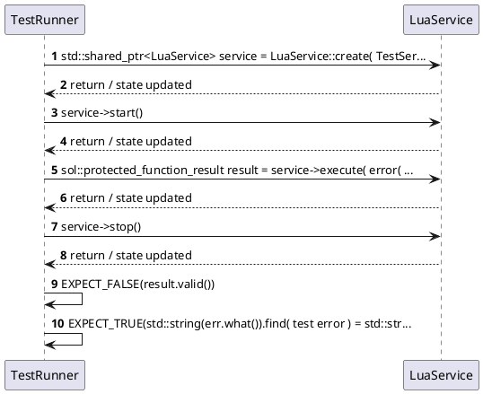

# Test Case: `LuaServiceTest.ErrorHandling`

| Property | Value |
| :--- | :--- |
| **Module** | `scripting` |
| **Source File** | `cmake-projects/scripting/test/TestLuaService.cpp` (lines 83–94) |
| **Category** | Unit & Regression Verification |
| **Traceability** | See module specification (`FE-*` / `TSK-*`) |
| **Async Telemetry** | Standard GTest / CTest stdout |

## Summary

Executes verification scenario `LuaServiceTest.ErrorHandling` defined in `cmake-projects/scripting/test/TestLuaService.cpp`.

## Sequence Diagram

## Observed Operations

- `std::shared_ptr<LuaService> service = LuaService::create("TestService", root)`
- `service->start()`
- `sol::protected_function_result result = service->execute("error('test error')")`
- `service->stop()`

## Verification Assertions

- `EXPECT_FALSE(result.valid())`
- `EXPECT_TRUE(std::string(err.what()).find("test error") != std::string::npos)`

---

[Back to `scripting` Tests Overview](../scripting.md)
