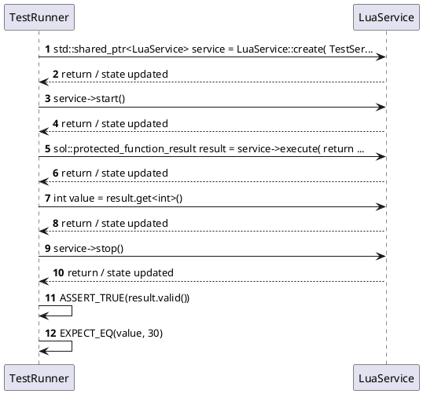

# Test Case: `LuaServiceTest.ScriptExecution`

| Property | Value |
| :--- | :--- |
| **Module** | `scripting` |
| **Source File** | `cmake-projects/scripting/test/TestLuaService.cpp` (lines 45–57) |
| **Category** | Unit & Regression Verification |
| **Traceability** | See module specification (`FE-*` / `TSK-*`) |
| **Async Telemetry** | Standard GTest / CTest stdout |

## Summary

Executes verification scenario `LuaServiceTest.ScriptExecution` defined in `cmake-projects/scripting/test/TestLuaService.cpp`.

## Sequence Diagram

## Observed Operations

- `std::shared_ptr<LuaService> service = LuaService::create("TestService", root)`
- `service->start()`
- `sol::protected_function_result result = service->execute("return 10 + 20")`
- `int value = result.get<int>()`
- `service->stop()`

## Verification Assertions

- `ASSERT_TRUE(result.valid())`
- `EXPECT_EQ(value, 30)`

---

[Back to `scripting` Tests Overview](../scripting.md)
