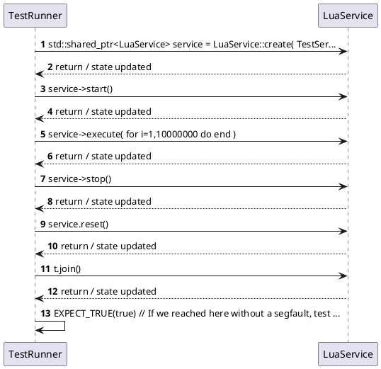

# Test Case: `LuaServiceTest.WorstCaseTermination`

| Property | Value |
| :--- | :--- |
| **Module** | `scripting` |
| **Source File** | `cmake-projects/scripting/test/TestLuaService.cpp` (lines 96–112) |
| **Category** | Unit & Regression Verification |
| **Traceability** | See module specification (`FE-*` / `TSK-*`) |
| **Async Telemetry** | Standard GTest / CTest stdout |

## Summary

Executes verification scenario `LuaServiceTest.WorstCaseTermination` defined in `cmake-projects/scripting/test/TestLuaService.cpp`.

## Sequence Diagram

## Observed Operations

- `std::shared_ptr<LuaService> service = LuaService::create("TestService", root)`
- `service->start()`
- `service->execute("for i=1,10000000 do end")`
- `service->stop()`
- `service.reset()`
- `t.join()`

## Verification Assertions

- `EXPECT_TRUE(true); // If we reached here without a segfault, test passed`

---

[Back to `scripting` Tests Overview](../scripting.md)
