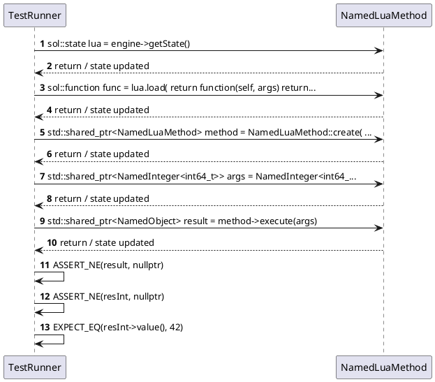

# Test Case: `NamedLuaMethodTest.Execution`

| Property | Value |
| :--- | :--- |
| **Module** | `scripting` |
| **Source File** | `cmake-projects/scripting/test/TestNamedLuaMethod.cpp` (lines 29–43) |
| **Category** | Unit & Regression Verification |
| **Traceability** | See module specification (`FE-*` / `TSK-*`) |
| **Async Telemetry** | Standard GTest / CTest stdout |

## Summary

Set up the test suite.

## Sequence Diagram

## Observed Operations

- `sol::state& lua = engine->getState()`
- `sol::function func = lua.load("return function(self, args) return args:asLong():value() * 2 end").call()`
- `std::shared_ptr<NamedLuaMethod> method = NamedLuaMethod::create("multiply", func, root)`
- `std::shared_ptr<NamedInteger<int64_t>> args = NamedInteger<int64_t>::create("args", 21)`
- `std::shared_ptr<NamedObject> result = method->execute(args)`

## Verification Assertions

- `ASSERT_NE(result, nullptr)`
- `ASSERT_NE(resInt, nullptr)`
- `EXPECT_EQ(resInt->value(), 42)`

---

[Back to `scripting` Tests Overview](../scripting.md)
