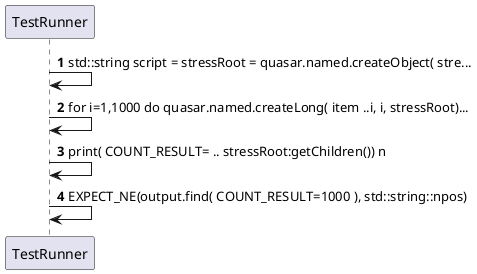

# Test Case: `QlshTest.HighVolumeStressTest`

| Property | Value |
| :--- | :--- |
| **Module** | `scripting` |
| **Source File** | `cmake-projects/scripting/test/TestQlsh.cpp` (lines 284–292) |
| **Category** | Determinism, Fuzzing, Concurrency & Stress (`CS-0100.7`, `CS-0100.10`, `CS-0100.11`, `CS-0100.12`) |
| **Traceability** | See module specification (`FE-*` / `TSK-*`) |
| **Async Telemetry** | Standard GTest / CTest stdout |

## Summary

Stress test: creating a massive tree and verifying structural integrity.

## Sequence Diagram

## Observed Operations

- `std::string script = "stressRoot = quasar.named.createObject('stress')\n"`
- `"for i=1,1000 do quasar.named.createLong('item'..i, i, stressRoot) end\n"`
- `"print('COUNT_RESULT=' .. #stressRoot:getChildren())\n"`

## Verification Assertions

- `EXPECT_NE(output.find("COUNT_RESULT=1000"), std::string::npos)`

---

[Back to `scripting` Tests Overview](../scripting.md)
